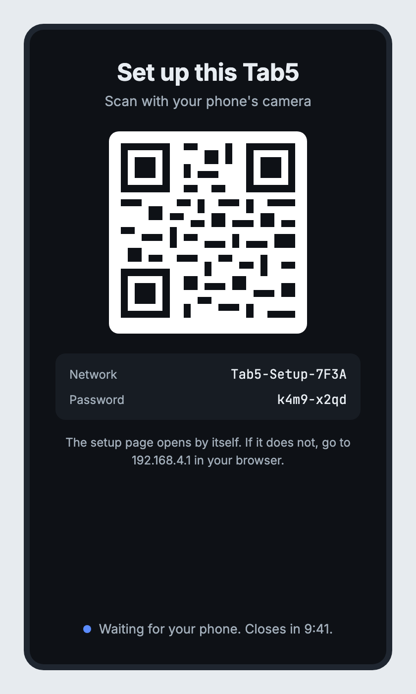
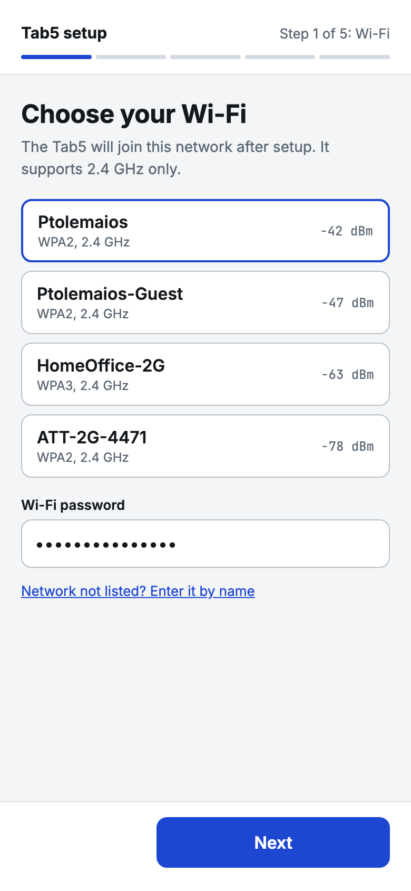
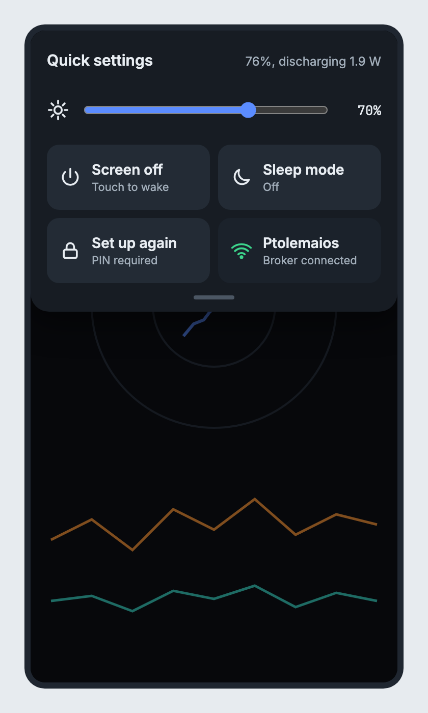
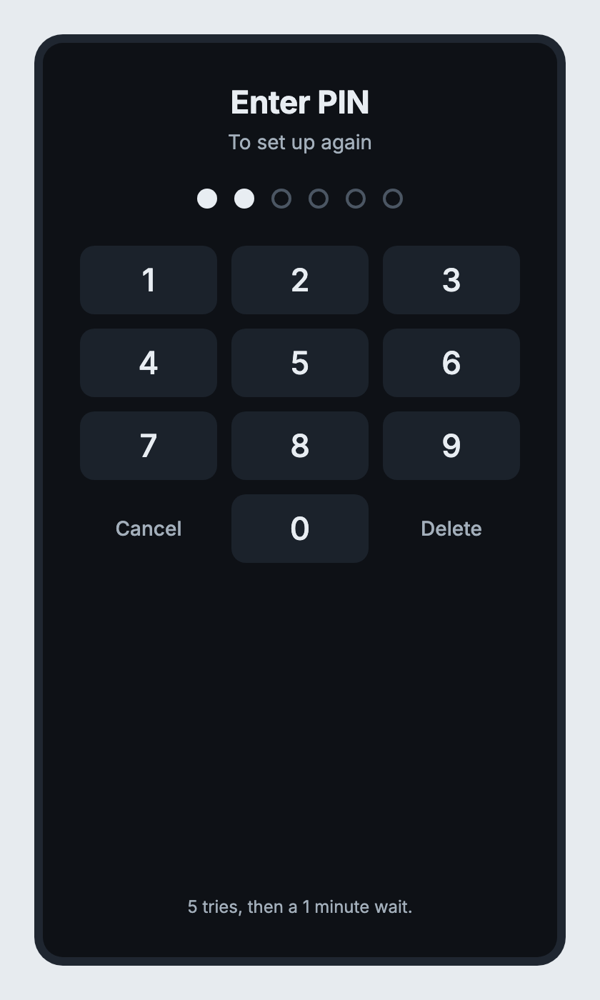

# Tab5 IMU and power telemetry

Firmware for the M5Stack Tab5 (ESP32-P4, with an ESP32-C6 coprocessor that provides Wi-Fi over esp-hosted) that:

- reads the on-board BMI270 IMU at 100 Hz and draws it live on the 720x1280 screen;
- measures battery power with the INA226 and estimates stored energy and time left;
- streams everything to an MQTT broker over Wi-Fi with TLS and a login;
- takes commands back from the broker: screen on/off, brightness, microphone, sleep;
- sets itself up on first run from a phone, with no Wi-Fi name, passwords or certificates built into the firmware;
- recovers on its own when the Wi-Fi/MQTT link wedges.

A browser dashboard (`viewer/`) shows the stream, plots it, controls the Tab5 and plays the microphone.
Scripts under `broker/` set up a local Mosquitto broker, and scripts under `tools/` test the whole chain.

## Contents

| Path | What it is |
|---|---|
| `src/main.cpp` | The firmware: tasks for sampling, drawing, power, microphone and MQTT; the quick-settings panel |
| `src/prov.*` | Stored settings: encrypted Wi-Fi/broker secrets, certificates, the PIN and its lockout |
| `src/setup_mode.*`, `src/portal_page.h` | First-run setup: the Tab5's own Wi-Fi network, QR code, and the setup page served to your phone |
| `src/pin_screen.*` | The PIN keypad shown before "set up again" |
| `broker/` | Mosquitto config, access lists, and the scripts that create certificates (`setup-tls.sh`, `issue-device-cert.sh`) and start the broker; `broker/provision/` holds the files you upload on the setup page |
| `viewer/index.html` | The dashboard: cards (battery power, acceleration, rotation rate, and a joystick card only while a unit is detected) that fill the window so nothing scrolls, and fall back to one scrolling column on a narrow or short window. Opens straight from disk; no server needed |
| `tools/endurance.py` | Long-running health test of the whole chain |
| `tools/powerbench.py` | Measures what each part of sleep mode saves, from the battery sensor |
| `spike/` | Test builds: `provtest` (storage self-test), `setuptest` (setup mode on its own), `joytest` (the joystick unit's raw values), `spike` (the feasibility experiment) |

## Hardware

- M5Stack Tab5. The board definition (`m5stack-tab5-p4`) targets the "ES pre rev.300" P4 silicon.
- Battery: the firmware assumes the 2S NP-F550 pack (2000 mAh, 7.4 V, 14.8 Wh) for stored energy and time left. Change `BAT_WH` in `src/main.cpp` if you fit another battery.
- The INA226 sits on the battery path. On USB it shows charge current; on battery it shows what the whole tablet draws.
- Wi-Fi is 2.4 GHz only (the C6).
- Optional: an [M5Stack I2C Joystick 2 Unit](https://shop.m5stack.com/products/i2c-joystick-2-unit-stm32g030) (STM32G030, I2C address 0x63) on Port A, the Tab5's Grove connector (SCL GPIO54, SDA GPIO53, 5 V). It can be plugged in or out while the Tab5 runs.

## Setup

You need PlatformIO, Podman (for the broker) and Python 3.

1. **Create the broker certificates and credentials** (one time; re-run if the Mac's LAN address changes, because the certificate is bound to it):

   ```
   broker/setup-tls.sh                          # or: broker/setup-tls.sh <broker-ip>
   broker/setup-tls.sh --password <password>    # optional: choose the broker password instead of a random one
   ```

   This creates a private CA, a server certificate, and the MQTT user `tab5` with a random password (or the one you give). It writes `include/mqtt_creds.h` for the test tools and puts the public CA certificate in `broker/provision/ca.crt`, the file you upload on the Tab5's setup page. Nothing here is committed. A short password is fine for testing, but the broker listens on your LAN, so use a random one for real.

   To sign in with a certificate instead of a password, also issue a device certificate:

   ```
   broker/issue-device-cert.sh [name]           # default name: tab5-device
   ```

   This makes a new key and a certificate for the Tab5, signed by the same CA, in `broker/provision/` (`tab5.crt` and `tab5.key`, with `ca.crt` copied beside them). The name becomes the MQTT username. The key is not encrypted, so treat the folder like a password; it is git-ignored. Re-running makes a new pair.

2. **Start the broker**:

   ```
   broker/run.sh
   ```

   Port 8883 is MQTT over TLS with a username and password. Port 8884 is MQTT over TLS with a device certificate and no password: the client must present a certificate issued by the CA, and its name is used as the username (Mosquitto cannot mix the two methods on one port). Both are reachable from the LAN. Port 9001 is MQTT over WebSockets, bound to `127.0.0.1` only, read-only plus the command topic, no login (the viewer).

3. **Build and flash**:

   ```
   pio run -t upload
   ```

   Use the `pio` that is on your PATH. The one inside `~/.platformio/penv` is too old for this platform and will uninstall it.

4. **Set the Tab5 up from your phone.** A Tab5 with nothing stored opens first-run setup by itself (see "First-run setup" below). No network name, password or certificate is built into the firmware.

5. **Open the viewer**: open `viewer/index.html` in a browser. It connects to `ws://localhost:9001`.

6. **Optional, for the tools**:

   ```
   python3 -m venv tools/.venv
   tools/.venv/bin/pip install -r tools/requirements.txt
   ```

Opening the Tab5's serial port resets the board (this is how the USB serial on the P4 behaves). Expect a restart whenever a serial monitor or `--serial` opens it.

## On the Tab5

The dashboard shows a g-force scope, gyro rate dials, a linear-acceleration history, and a 30 s battery power chart. The header has two small status symbols and the message rate:

- **Wi-Fi symbol**: arcs light up with signal strength (three green at -60 dBm or better, two green to -70, one amber to -80, one red below). While joining, the arcs sweep in amber; after 30 s down they sweep in red with a slash.
- **Broker symbol**: a two-unit server. Green when connected, with the lower dot flickering as messages go out. While connecting it is amber with the dots blinking in turn; after 30 s it is red with a slash.
- **`N msg/s >>> host:port`**: the arrows sweep while the link is up and stay red and still when it is down.

### Quick settings

Swipe down from the very top edge. The dashboard dims and a panel slides down:

- a brightness slider (5-100%);
- **power symbol**: turn the screen off;
- **Wi-Fi** and **server** symbols: link status;
- **moon**: sleep mode;
- **padlock** (second row): set up again, behind the PIN.

Close it with a swipe up or by tapping the dimmed area. With the screen off, touching anywhere wakes it; that touch is not passed on.

### Sleep mode

Chosen from the moon tile or with the `sleep` command; it never starts by itself. It turns the screen off, stops the microphone, drops the CPU from 360 MHz to 40 MHz, samples the IMU at 10 Hz instead of 100 Hz, and sends 2 IMU readings and 1 power reading per second instead of 50 and 10. Touch the screen or send `wake` to end it. On wake the full clock is restored before the screen lights; the screen is lit about 30 ms after the touch is seen.

Measured on battery (USB unplugged), the battery draw goes from about 1.8 W awake to about 0.72 W in sleep mode: roughly 8 hours versus 20 hours on a full pack. Of the 1.08 W saved, the backlight is about 0.76 W, slower rates about 0.25 W, and the 40 MHz clock about 0.1 W. Wi-Fi deep power save added nothing measurable.

The display panel is deliberately left awake. The Tab5's ST7123 is a combined display and touch controller, so putting the panel to sleep also switches off touch and nothing could wake the screen by touch. Panel sleep would save another 0.17 W, but then only the `wake` command could end sleep.

### Joystick

With a Joystick 2 Unit on Port A, swipe sideways (left) on the dashboard to open the **Joystick** page, and swipe right to go back. It shows a pad with a dot and a fading trail of the last 0.8 s, a red highlight while the stick is pressed, the X and Y readings, and a 6-second history chart. A small green joystick symbol in the dashboard header shows that a unit is connected. The page exists only while a unit is detected: without one, swiping does nothing, and if the unit is unplugged while the page is open the Tab5 goes back to the dashboard. The viewer follows the same rule, see "Modules" below.

- **Scale:** the unit clips each axis at 4095 on its own, but the stick moves in a circle, so a full push read 4095 along an axis and up to about 4700 on a diagonal. The firmware scales by 4095 and clamps the length of the stick vector to 1, so a full push in any direction is exactly **100%**. X and Y are published in percent, -100.0 to +100.0. The unit's own calibrated values stay available as `rx` and `ry` (-4095 to +4095).
- **Orientation:** which way is "up" depends on how the unit is held. Three buttons on the page (and in the viewer) fix it: Flip X, Flip Y and Swap X/Y, remembered across restarts. Hold the unit with its cable toward you: pushing away from you should move the dot up.
- **Sleep mode** polls the unit at 2 Hz and sends 2 readings per second; awake it is read at 50 Hz and 25 readings per second are sent.

### Modules: pages and cards that appear when something is detected

A page on the Tab5 and a card in the viewer exist only for modules that are there. The Tab5 announces what it has on `tab5/caps`; a viewer asks with the `caps` command when it connects (and again every 2 s, up to 5 times, until it gets an answer), and has a "Detect modules" button to ask again. The Tab5 also announces by itself after every connect and when a module is plugged in or out, so a joystick card appears within about a second of plugging the unit in and disappears when it is pulled out. With the joystick absent the viewer shows three cards and the rotation card takes the whole bottom row. A firmware that does not answer `caps` is handled too: the viewer then shows the joystick card only while joystick readings with a unit connected keep arriving.

### First-run setup

With nothing stored, the Tab5 shows a QR code and opens its own Wi-Fi network (`Tab5-Setup-xxxx`, with a random password shown on screen).

1. Scan the QR code with your phone and join the network. The setup page can open by itself as a sign-in sheet, but on an iPhone that took 35 to 60 seconds in every try (by QR code and by hand), although the Tab5 serves the page about 3 seconds after the phone joins; the wait is inside iOS. To skip it, open `192.168.4.1` in the browser right after joining.
2. Fill in the five steps: **Wi-Fi** (pick from the scanned list, or type the name), **Broker** (address, port, and how to sign in), **Certificates**, **PIN**, then **Check and save**.
3. For the broker you choose one of two ways to sign in: **username and password** (port 8883, needs the CA certificate) or **device certificate** (port 8884, needs the CA certificate, a device certificate and its key, from `broker/issue-device-cert.sh`; copy the three files in `broker/provision/` to your phone, for example by AirDrop). Each certificate can be chosen as a file or pasted as text; the Tab5 checks it and tells you what it found (name, key type, expiry). For the device certificate it also checks that the key belongs to it and that the CA issued it.
4. Save. The Tab5 shows "Setup complete" and restarts onto the new settings.

<table>
<tr>
<td align="center" valign="top"><br>The Tab5 screen: scan the QR code</td>
<td align="center" valign="top"><br>The setup page on the phone, step 1 of 5</td>
</tr>
</table>

<p align="center"><em>Design mockups. The real screens follow them; the network names are examples. All the screens, step by step, are in <a href="docs/mockups.md">docs/mockups.md</a>.</em></p>

Setup closes after 10 minutes. On a first run the screen then says so and a touch starts it again. If settings that were just saved cannot join the Wi-Fi within 90 s, or reach the broker within 150 s, the Tab5 reopens setup with the reason shown (for example "The broker refused the login"). The page is plain HTTP, since there is no certificate a phone would trust for `192.168.4.1`. It is protected only by the random Wi-Fi password in the QR code, so setup only runs for a few minutes and closes once it is saved.

### Set up again

Swipe down for the quick-settings panel and tap the padlock tile. The Tab5 restarts and shows a PIN keypad. Cancel returns to normal running with the stored settings. The right PIN opens setup again, with the saved values filled in: saved passwords and the key show as "Unchanged" and are replaced only if you type new ones. After 5 wrong PINs the keypad locks for a minute, and a restart does not skip the wait.

<table>
<tr>
<td align="center" valign="top"><br>Quick settings (the finished panel is icon-only; the padlock is in a second row)</td>
<td align="center" valign="top"><br>The PIN keypad (the finished screen shows "Wrong PIN." or a lockout countdown instead of the "5 tries" line)</td>
</tr>
</table>

A forgotten PIN cannot be recovered. The way back is to erase the Tab5's flash and flash it again (for example `pio run -t erase`, then `pio run -t upload`; I have not tried this on this board). That erases everything stored, so the Tab5 runs first-run setup again.

### Stored settings

Settings are kept in the chip's NVS storage. The Wi-Fi password, the broker password and the device private key are encrypted with AES-256-GCM, using a key derived from the chip's unique ID, so they are not readable on the screen, the serial port or the network, and a raw dump of the flash does not contain them (a self-test checks this). The Wi-Fi name, broker address and the certificates are stored as they are. The PIN is stored only as a salted PBKDF2-HMAC-SHA256 hash. No eFuses are burned, so someone who dumps the flash and runs this firmware on the same chip could still recover the secrets. This keeps them away from the ordinary interfaces, not from a determined attacker with the hardware.

### Recovery

The esp-hosted link to the C6 can wedge, after which TLS cannot get enough internal RAM to reconnect. The firmware:

- resets Wi-Fi after 3 failed MQTT connects, at most once a minute;
- restarts the chip after 180 s without an MQTT link, or if the transmit task stops responding for 60 s, and gives up restarting after 3 restarts in a row without a connection (so a dead broker cannot cause a reboot loop);
- draws the display in 80 px strips, which leaves about 235 kB of internal RAM free for TLS.

## MQTT interface

| Topic | Direction | Content |
|---|---|---|
| `tab5/imu` | Tab5 to broker | JSON: `t` (ms), `ax ay az` (g), `gx gy gz` (deg/s), `roll pitch yaw` (deg). 50/s awake, 2/s asleep |
| `tab5/power` | Tab5 to broker | JSON, 10/s awake, 1/s asleep: `t v i p soc chg t_imu t_chip rssi heap mic avg wh eta scr bri slp`. `i` and `p` are positive when charging; `chg` is 1 charging, 0 idle, -1 discharging; `eta` is minutes to empty or full, -1 if not meaningful |
| `tab5/audio` | Tab5 to broker | Raw 16-bit mono PCM at 16 kHz in 1024-byte blocks, only while the microphone is on |
| `tab5/joy` | Tab5 to broker | JSON, 25/s awake, 2/s asleep, and at once when the unit is plugged in or out: `t ok x y rx ry b fx fy sw`. `ok` is 1 when a unit is connected; `x`, `y` are -100.0 to +100.0 (percent of a full push, after the orientation switches); `rx`, `ry` are the unit's calibrated -4095 to +4095; `b` is 1 while the stick is pressed; `fx fy sw` are the orientation switches |
| `tab5/caps` | Tab5 to broker | JSON, sent when asked, after every (re)connect and whenever a module is plugged in or out: `t fw caps`. `fw` is the firmware build time; `caps` lists the modules this Tab5 has right now: `imu power screen mic sleep` always, and `joystick` only while a unit answers on Port A |
| `tab5/cmd` | broker to Tab5 | Text commands, below |

Commands:

| Command | Effect |
|---|---|
| `screen on` / `screen off` | Turn the screen on or off (on also ends sleep) |
| `brightness 0-255` | Set the brightness |
| `mic on` / `mic off` | Start or stop microphone streaming (ignored in sleep) |
| `sleep` / `wake` | Enter or leave sleep mode |
| `caps` or `detect` | Announce the modules this Tab5 has, on `tab5/caps` (answered within about 30 ms) |
| `joy flipx`, `joy flipy`, `joy swap`, `joy reset` | Toggle an orientation switch of the joystick, or put all three back to off |
| `rates slow` / `rates normal`, `ps on` / `ps off`, `panel on` / `panel off`, `cpu <MHz>` | The individual parts of sleep mode, for measuring. The CPU clock only changes while the screen is off. `panel on` puts the display panel to sleep, which also disables touch, so only `wake` can end sleep then |

The access lists let a device (either sign-in method) use only `tab5/#`. The viewer's access list lets it read `tab5/#` and write only `tab5/cmd`.

## Testing

Close the browser viewer first for both tools; anything else publishing to `tab5/cmd` interferes.

```
# the joystick unit on Port A: scans the bus and prints its raw values (a test build, not the dashboard)
pio run -e joytest -t upload

# the settings storage on the device: encryption, tamper checks, "secrets are not in flash", PIN and lockout (about 3 minutes)
pio run -e provtest -t upload          # then read the serial port; it prints PASS or FAIL for each check

# the setup mode on its own, to try it with a phone without the rest of the firmware
pio run -e setuptest -t upload

# 30 minutes of health checks: stalls, rates, memory, reboots, commands, device log
tools/.venv/bin/python tools/endurance.py --minutes 30 --serial /dev/cu.usbmodem2101

# what each part of sleep mode saves. Unplug USB first: on USB the sensor shows charge current
tools/.venv/bin/python tools/powerbench.py
tools/.venv/bin/python tools/powerbench.py --cpus 180,90,40     # real sleep mode at each CPU clock
```

`endurance.py` prints a PASS/FAIL table; the exit status is 0 only if every check passes. While it runs the screen goes off for a couple of seconds every few minutes and the microphone turns on briefly; it restores the screen, microphone and brightness at the end.

## Notes and limits

- A lower CPU clock starves the display (noise, 1 fps) and can leave it in a bad state until a reset, so the firmware only honours it while the screen is off and restores 360 MHz before the screen lights; if the transmit task has not done so within 0.4 s the display task does it. While the clock is at 40 MHz the display driver logs "can't fetch data from external memory fast enough" on the serial port. The screen is dark then and the messages stop once the clock is back.
- The Wi-Fi signal reading and the access-point status are calls into the C6 that can block when the C6 does not answer. The firmware polls the signal every 10 s and stops for good after the first timeout; the symbol then shows plain "connected".
- `broker/setup-tls.sh` binds the server certificate to the Mac's LAN address. If DHCP gives the Mac a new address, re-run it, restart the broker, and set the Tab5 up again with the new address. Reserving the address on the router avoids this.
- The broker container restarts with Podman but not after a reboot of the Podman VM; run `broker/run.sh` again.

## Roadmap

- Tried on the device: the setup page's refusals (a non-key, a non-certificate, a non-text file, a key that does not belong to the certificate, a certificate from another CA), a 4.8 KB certificate bundle pasted (accepted) and a 12 KB one (refused as too large), the PIN lockout (five wrong PINs, the countdown, a retry after the wait locks again, the right PIN opens setup), and settings with a wrong Wi-Fi password (setup reopens behind the PIN after about 90 s with the reason, and recovers once the right password is saved).
- Checked only by reading the code: the "broker refused the login" and "could not reach the broker" messages (the Wi-Fi one was seen), and that the PIN lock survives a restart (while the failure count is 5 or more, every restart locks the keypad for a minute until one right PIN resets it).
- Not tested: Android's captive-portal check on the setup network (there was no Android phone; the Tab5 redirects every unknown address to the setup page, which is the standard signal), and the erase-and-reflash recovery for a forgotten PIN.
- Known limit: the Tab5 waits for the clock (NTP) before it tries the broker, so on a network without internet a failed first connection would be reported as "could not reach the broker".
- Certificate sign-in is built and was tried end to end (the Tab5 connects on 8884 and the broker records it as `tab5-device`), but there is no way yet to revoke a single device certificate other than replacing the CA.

`spike/spike.cpp` is the throwaway firmware that first confirmed the access point, captive page, form posts and touch work on this hardware. Build it with `pio run -e spike -t upload`; a plain `pio run` still builds the real firmware.
