# Setting up the Tab5, step by step

This takes a new Tab5 from a box to a live dashboard: a broker on your computer, the firmware on the Tab5, the Tab5 told about your Wi-Fi and broker from a phone, and the viewer open in a browser. Allow about 20 minutes.

> **About the pictures.** The pictures of the Tab5 screen and of the setup page on the phone are **design mockups**, not photos. The finished screens follow them, and a note under each picture says where they differ. The Wi-Fi name `Ptolemaios` and the other network names are examples. All the mockups on one page are in [mockups.md](mockups.md).

| Step | What you do | Where |
|---|---|---|
| [1](#1-install-the-tools) | Install the tools | Computer |
| [2](#2-create-the-broker-certificates-and-password) | Create the broker certificates and password | Computer |
| [3](#3-start-the-broker) | Start the broker | Computer |
| [4](#4-build-and-flash-the-firmware) | Build and flash the firmware | Computer, Tab5 on USB |
| [5](#5-the-tab5-opens-first-run-setup) | The Tab5 opens first-run setup | Tab5 |
| [6](#6-join-the-tab5s-wi-fi-from-your-phone) | Join the Tab5's Wi-Fi from your phone | Phone |
| [7](#7-setup-page-step-1-wi-fi) | Setup page, step 1: Wi-Fi | Phone |
| [8](#8-setup-page-step-2-broker) | Setup page, step 2: broker | Phone |
| [9](#9-setup-page-step-3-certificates) | Setup page, step 3: certificates | Phone |
| [10](#10-setup-page-step-4-pin) | Setup page, step 4: PIN | Phone |
| [11](#11-setup-page-step-5-check-and-save) | Setup page, step 5: check and save | Phone |
| [12](#12-check-that-it-is-running) | Check that it is running | Tab5 |
| [13](#13-open-the-viewer) | Open the viewer | Computer |
| [14](#14-optional-the-test-tools) | Optional: the test tools | Computer |

## 1. Install the tools

You need three things on the computer:

- **PlatformIO** (`pio`), to build and flash the firmware.
- **Podman**, to run the Mosquitto broker in a container (`brew install podman`).
- **Python 3**, for the optional test tools.

Use the `pio` that is on your PATH. The one inside `~/.platformio/penv` is too old for this platform and will uninstall it.

## 2. Create the broker certificates and password

One time. Re-run it if the computer's LAN address changes, because the server certificate is bound to that address.

```
broker/setup-tls.sh                          # or: broker/setup-tls.sh <broker-ip>
broker/setup-tls.sh --password <password>    # optional: choose the password instead of a random one
```

The script prints these lines as it goes (some only the first time):

```
created CA
server cert issued for <your LAN address>
created MQTT user 'tab5'
wrote include/ca_cert.h and include/mqtt_creds.h
public files for the setup page are in broker/provision/ (ca.crt)
next: broker/run.sh, then rebuild + flash the firmware
```

It creates a private CA, a server certificate and the MQTT user `tab5`. It writes `include/mqtt_creds.h` for the test tools and puts the public CA certificate in `broker/provision/ca.crt`, the file you upload on the Tab5's setup page. Nothing here is committed. A short password is fine for testing, but the broker listens on your LAN, so use a random one for real. The password may only contain letters, digits, `.`, `_` and `-`.

**Only if you want to sign in with a certificate instead of a password**, also issue a device certificate:

```
broker/issue-device-cert.sh [name]           # default name: tab5-device
```

```
issued device certificate 'tab5-device' (valid 825 days)
  files for the Tab5 setup page: broker/provision/ca.crt  tab5.crt  tab5.key
  the broker's certificate port is 8884; restart the broker with broker/run.sh if you have not since this was added
```

This makes a new key and a certificate signed by the same CA in `broker/provision/` (`tab5.crt` and `tab5.key`, with `ca.crt` beside them). The name becomes the MQTT username. The key is not encrypted, so treat the folder like a password; it is git-ignored. Re-running makes a new pair.

## 3. Start the broker

```
broker/run.sh
```

```
broker 'tab5-mqtt' running
  LAN address: <your LAN address>  (must match MQTT_HOST in include/secrets.h)
  watch:  podman exec tab5-mqtt mosquitto_sub -t tab5/imu
  viewer: open <this folder>/../viewer/index.html
```

The broker listens on three ports:

| Port | What | Who can reach it |
|---|---|---|
| 8883 | MQTT over TLS, username and password | the LAN |
| 8884 | MQTT over TLS, device certificate, no password (the certificate's name is the username) | the LAN |
| 9001 | MQTT over WebSockets, no login, read-only plus the command topic | this computer only (`127.0.0.1`), for the viewer |

Mosquitto cannot mix the password and certificate methods on one port, hence two ports. If `podman` is not found the script says so; if step 2 has not been done it says `run broker/setup-tls.sh first`.

The container restarts with Podman but not after a reboot of the Podman VM; run `broker/run.sh` again then.

## 4. Build and flash the firmware

Connect the Tab5 by USB and run:

```
pio run -t upload
```

Nothing about your network is built into the firmware, so you do this once. Opening the Tab5's serial port resets the board (this is how the USB serial on the P4 behaves), so expect a restart whenever a serial monitor opens it.

## 5. The Tab5 opens first-run setup

A Tab5 with nothing stored starts setup by itself. It shows a QR code and opens its own Wi-Fi network, `Tab5-Setup-xxxx`, with a random password that is also shown on the screen.

<p align="center">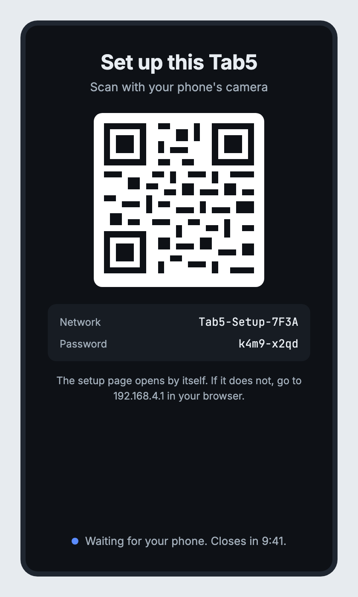<br>The Tab5 screen: scan the QR code. (The QR code in the mockup is a placeholder pattern; the real screen draws a real one.)</p>

Setup closes after 10 minutes. On a first run the screen then says so, and a touch starts it again.

## 6. Join the Tab5's Wi-Fi from your phone

Scan the QR code with your phone's camera and join the network.

The setup page can open by itself as a sign-in sheet. **On an iPhone that took 35 to 60 seconds in every try**, by QR code and by hand, although the Tab5 serves the page about 3 seconds after the phone joins; the wait is inside iOS. To skip it, open `192.168.4.1` in the browser right after joining. (Android's behaviour has not been tested.)

While the phone fills in the page, the Tab5 shows that a phone is connected.

<p align="center">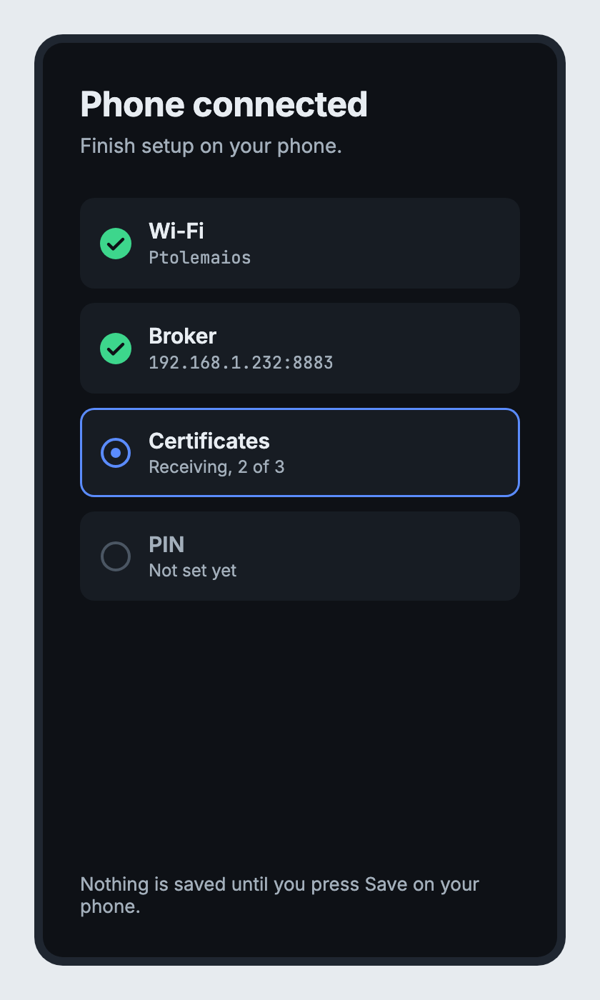<br>The Tab5 while the phone is on the setup page. (The finished firmware lists all four items as waiting until Save is pressed, rather than ticking them off live.)</p>

The page is plain HTTP, since there is no certificate a phone would trust for `192.168.4.1`. It is protected only by the random Wi-Fi password in the QR code, which is why setup only runs for a few minutes and closes once it is saved.

## 7. Setup page, step 1: Wi-Fi

Pick your network from the scanned list, or type its name, and enter its password. **The Tab5 joins 2.4 GHz networks only.**

<p align="center">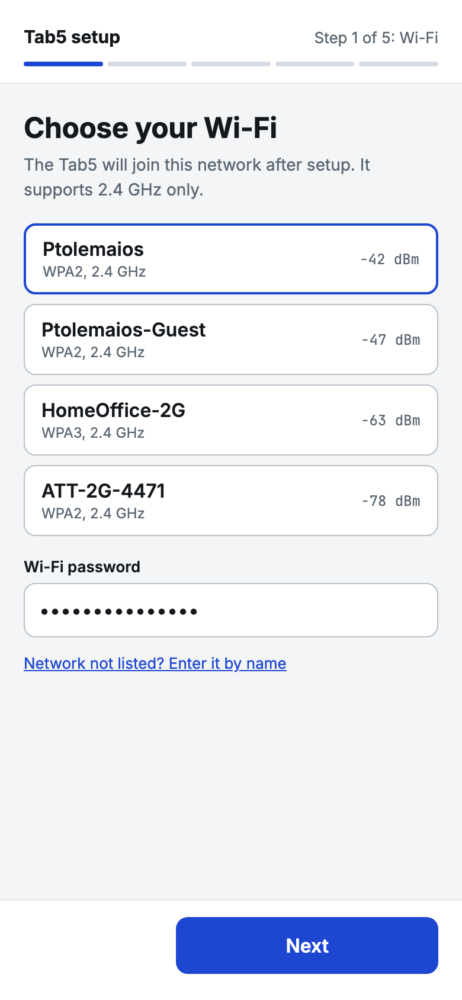<br>Step 1 of 5.</p>

## 8. Setup page, step 2: broker

Enter the broker's address (your computer's LAN address, the one `broker/run.sh` printed) and choose how the Tab5 signs in.

<table>
<tr>
<td align="center" valign="top">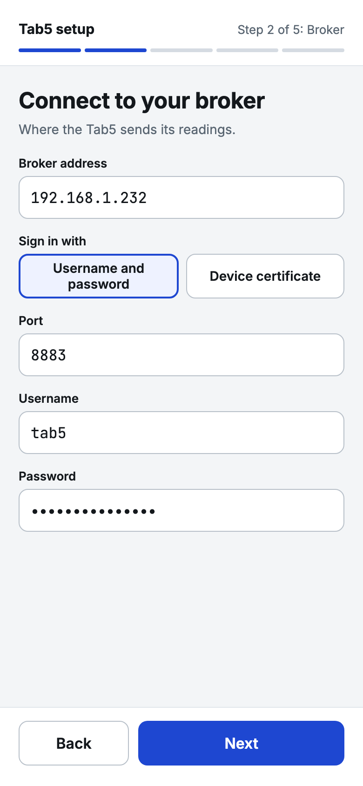<br><b>Username and password</b><br>Port 8883, user <code>tab5</code>, the password from step 2. Needs the CA certificate.</td>
<td align="center" valign="top">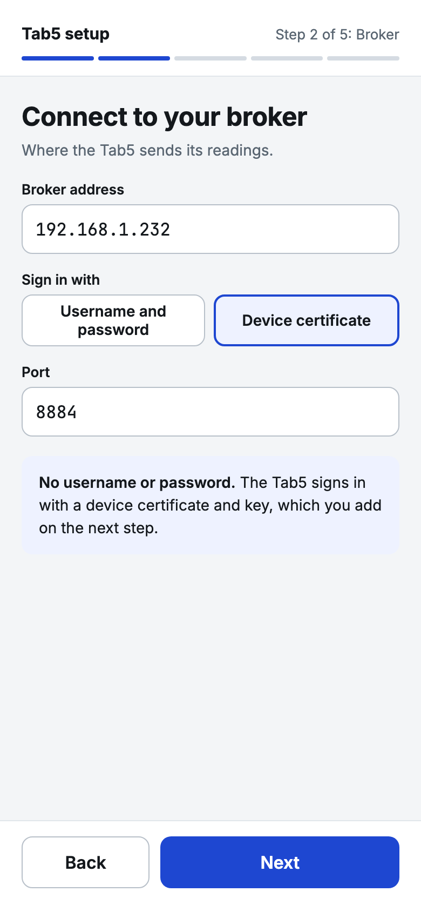<br><b>Device certificate</b><br>Port 8884, no username or password. Needs the CA certificate, a device certificate and its key.</td>
</tr>
</table>

## 9. Setup page, step 3: certificates

The Tab5 needs the files in `broker/provision/`. Get them onto your phone, for example by AirDrop: just `ca.crt` for the password path, all three of `ca.crt`, `tab5.crt` and `tab5.key` for the certificate path. Each one can be chosen as a file or pasted as text.

<table>
<tr>
<td align="center" valign="top">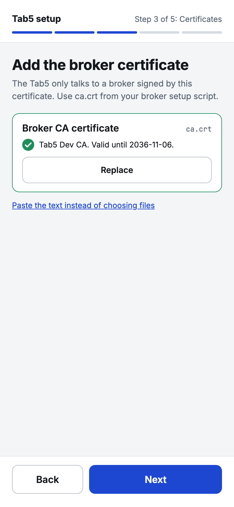<br><b>Password path</b><br>Only the CA certificate card.</td>
<td align="center" valign="top">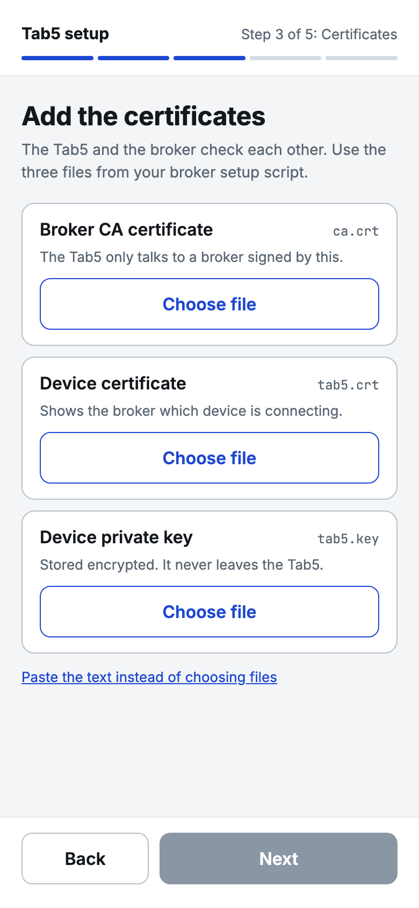<br><b>Certificate path</b><br>Three cards. Next stays grey until all three are in.</td>
<td align="center" valign="top">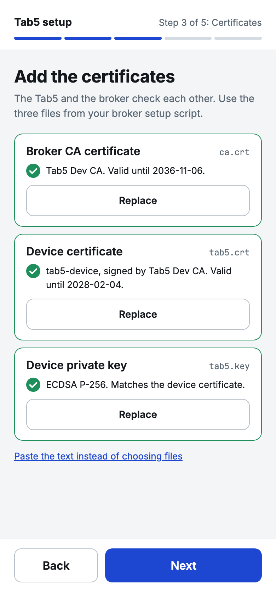<br><b>All accepted</b><br>The Tab5 reads each one and reports what it found: name, key type and expiry.</td>
</tr>
</table>

For the device certificate the Tab5 also checks that the key belongs to it and that the CA issued it. It refuses a file that is not a key or a certificate, a key that does not belong to the certificate, a certificate from another CA, and a bundle larger than about 12 KB.

## 10. Setup page, step 4: PIN

Choose a six-digit PIN and enter it twice. The Tab5 asks for it before it lets you set it up again.

<p align="center">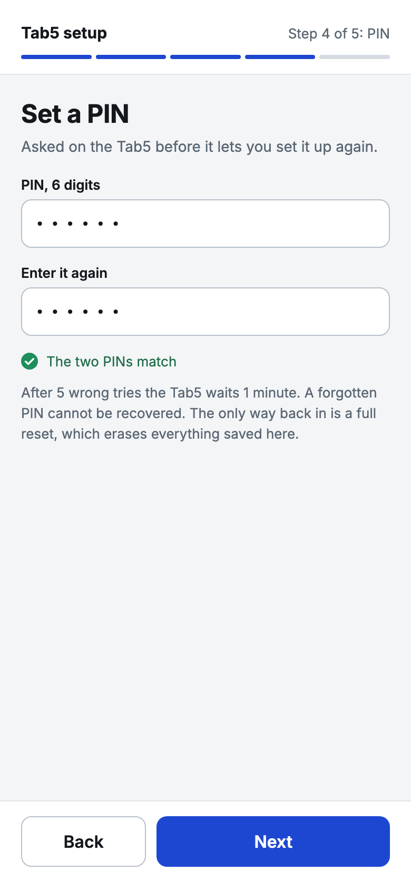<br>Step 4 of 5.</p>

**A forgotten PIN cannot be recovered.** See [Forgot the PIN](#forgot-the-pin) below.

## 11. Setup page, step 5: check and save

Check the summary (secrets are masked) and save.

<table>
<tr>
<td align="center" valign="top">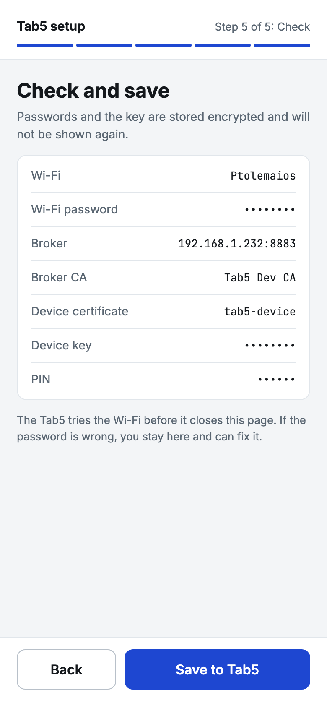<br><b>Check and save</b><br>The page says the Tab5 reopens setup if the new settings cannot connect. It does not hold this page open to test them, because the setup network drops when the Tab5 joins your Wi-Fi.</td>
<td align="center" valign="top">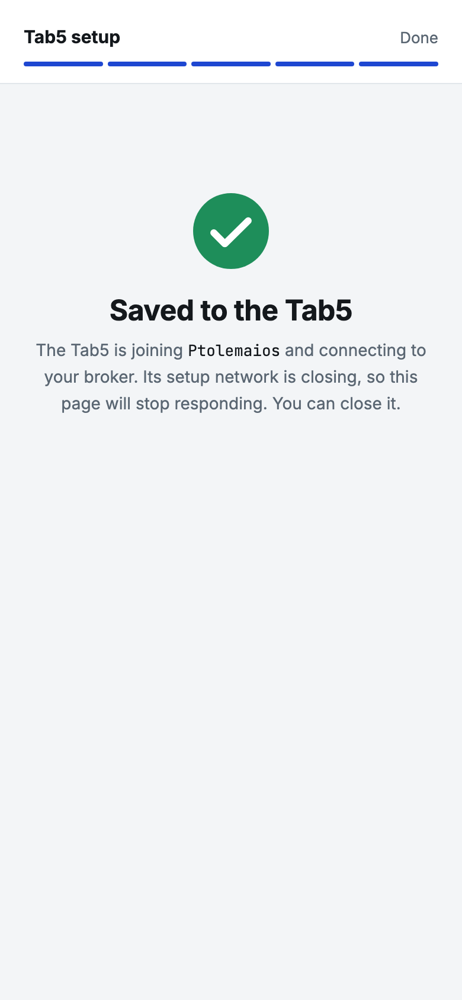<br><b>Saved</b><br>The Tab5 restarts, so this page stops responding. Close it.</td>
<td align="center" valign="top">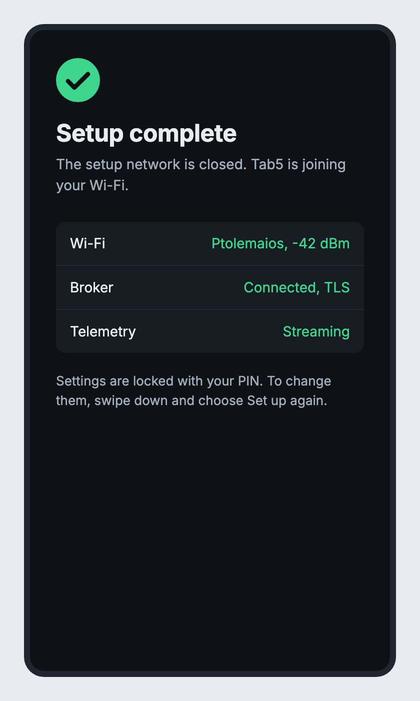<br><b>On the Tab5</b><br>"Setup complete" for a few seconds, then it restarts onto the new settings.</td>
</tr>
</table>

## 12. Check that it is running

After the restart the Tab5 joins your Wi-Fi and the broker, and the dashboard appears. Look at the two symbols in its header:

- **Wi-Fi symbol**: arcs light up with signal strength (three green at -60 dBm or better, two green to -70, one amber to -80, one red below). While joining they sweep in amber.
- **Broker symbol**: a two-unit server, green when connected. While connecting it is amber with the dots blinking in turn.
- **`N msg/s >>> host:port`**: the arrows sweep while the link is up.

**If the saved settings do not work**, the Tab5 reopens setup by itself and shows the reason, for example "The broker refused the login". It does so if it cannot join the Wi-Fi within 90 s or reach the broker within 150 s. Setup then opens behind the PIN keypad; enter your PIN, fix the value and save again.

## 13. Open the viewer

Open `viewer/index.html` in a browser. It opens straight from disk and connects to `ws://localhost:9001`, the broker's local-only WebSocket port. The side panel should show **Broker connected** and **Tab5 streaming**.

<p align="center">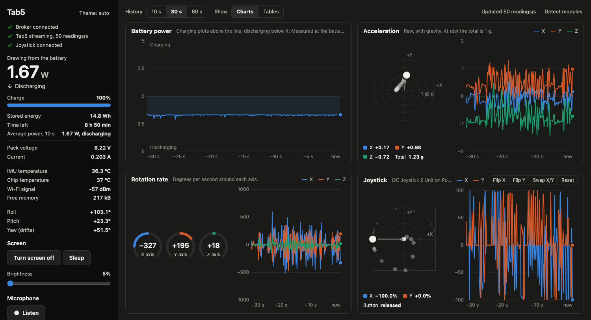<br>The viewer with the Tab5 streaming (a real screenshot). The Joystick card is there only because a Joystick 2 Unit was plugged in; without one you see three cards and the rotation card takes the whole bottom row.</p>

Tilt the Tab5 and the acceleration and rotation plots move. If the side panel stays on "Waiting for the broker", the broker is not running (step 3).

## 14. Optional: the test tools

```
python3 -m venv tools/.venv
tools/.venv/bin/pip install -r tools/requirements.txt
```

The tools and what they do are in the [README](../README.md#testing).

---

## Setting up again

To change the Wi-Fi, the broker or the certificates later: swipe down from the very top edge of the Tab5 for the quick-settings panel and tap the **padlock** tile (second row). The Tab5 restarts and shows a PIN keypad. **Cancel** returns to normal running with the stored settings. The right PIN opens setup again with the saved values filled in; saved passwords and the key show as "Unchanged" and are replaced only if you type new ones.

<table>
<tr>
<td align="center" valign="top">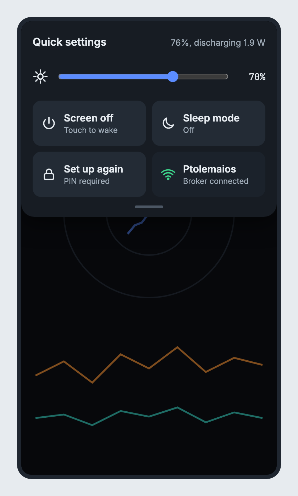<br>Quick settings. (The finished panel is icon-only; the padlock is in a second row.)</td>
<td align="center" valign="top">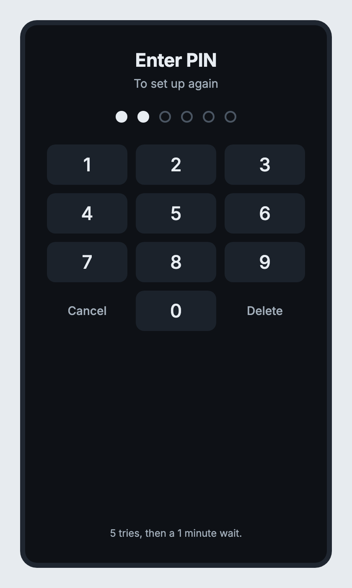<br>The PIN keypad. (The finished screen shows "Wrong PIN." or a lockout countdown instead of the "5 tries" line.)</td>
</tr>
</table>

After 5 wrong PINs the keypad locks for a minute, and a restart does not skip the wait.

## Forgot the PIN

A forgotten PIN cannot be recovered. The way back is to erase the Tab5's flash and flash it again:

```
pio run -t erase
pio run -t upload
```

That erases everything stored, so the Tab5 runs first-run setup again from step 5. This has **not been tried on this board**.

## Trouble

| What you see | What to do |
|---|---|
| The sign-in sheet takes a minute to appear on an iPhone | Wait, or open `192.168.4.1` in the browser right after joining (step 6) |
| Setup closed itself | It closes after 10 minutes. Touch the screen to start it again |
| The Tab5 reopens setup after saving | Read the reason on its screen (wrong Wi-Fi password, broker refused the login, broker not reachable) and save again |
| The broker is unreachable after your computer got a new LAN address | The server certificate is bound to the old address. Re-run `broker/setup-tls.sh`, restart the broker with `broker/run.sh`, and set the Tab5 up again with the new address. Reserving the address on your router avoids this |
| The viewer shows "Tab5 stopped sending" | Check the Tab5 is on, on Wi-Fi, and that the broker is running |
| A network without internet | The Tab5 waits for the clock (NTP) before it tries the broker, so a failed first connection there is reported as "could not reach the broker" |
