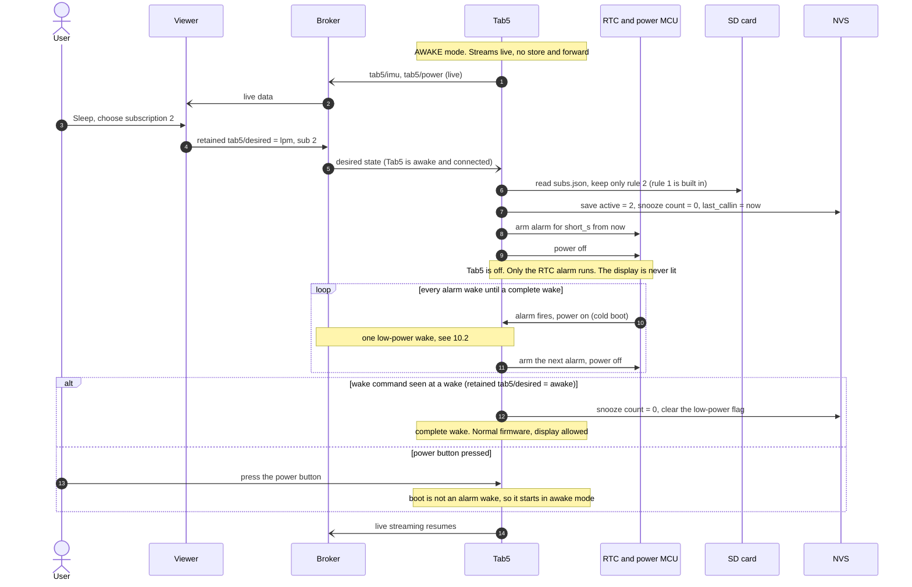
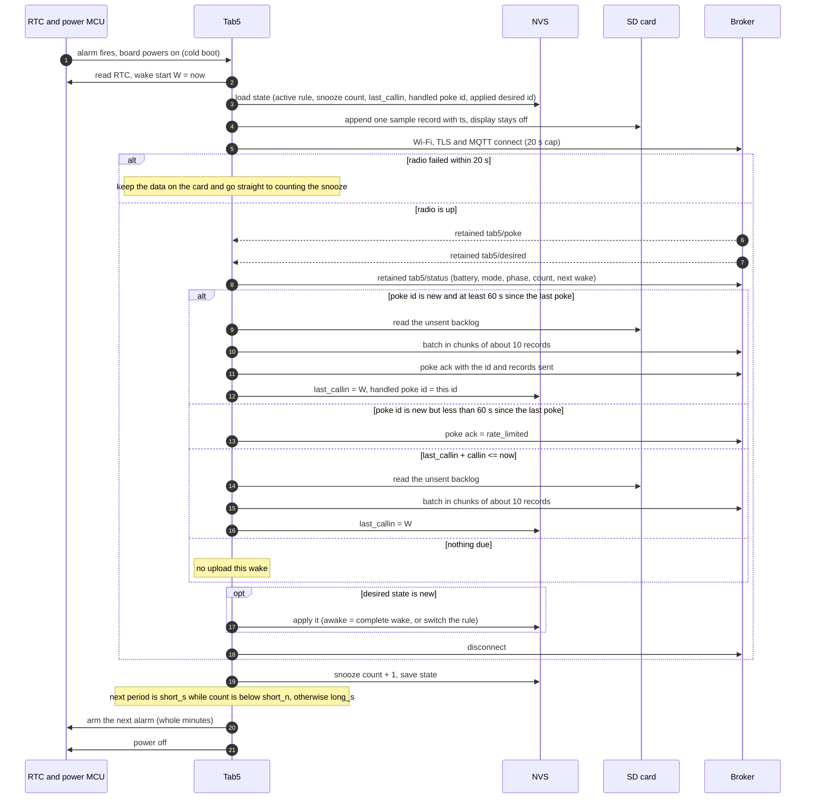
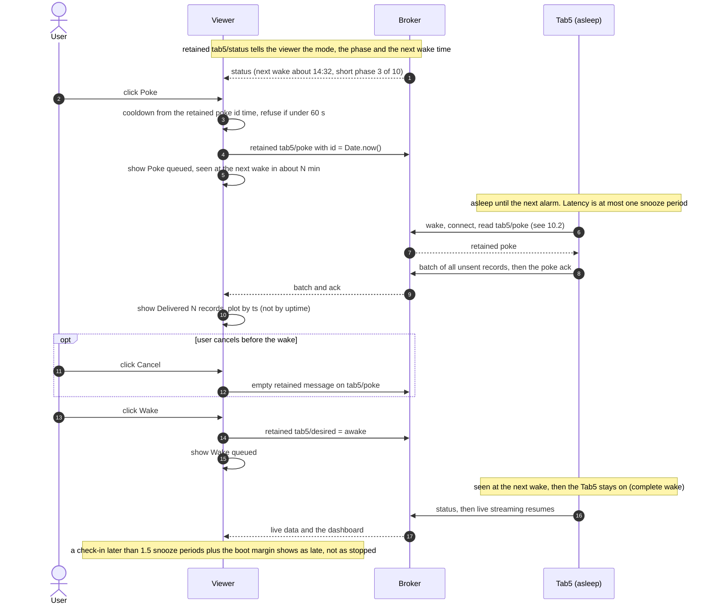

# Low-power mode and subscriptions: design and research

Status: **design only. Nothing in this document is built yet.** It records what was researched, what was tested on the
device, and what was decided, so the work can start from here. Items marked *proposed* were suggested and not objected to but
never explicitly confirmed. Numbers marked *estimate* are not measurements.

## 1. What this is

A low-power mode (LPM) in which the Tab5 spends almost all of its time powered off, wakes on an RTC alarm, records a sample,
checks in with the broker, uploads its recorded data only when the subscription says so (or when the user pokes it), and goes
back to sleep. How often it wakes and how often it uploads are set by a **subscription**.

Terms used below:

| Term | Meaning |
|---|---|
| Wake | One power-up caused by the RTC alarm. Every wake is a cold boot |
| Snooze | The time between two wakes. Whole minutes, set by the subscription |
| Call-in | An upload of the recorded data to the broker |
| Poke | A user request, from the viewer, that the next wake upload everything |
| Complete wake | Leaving LPM entirely and returning to the normal awake firmware |
| Awake mode | The normal firmware: it streams live and does not store and forward |

## 2. Decisions so far

1. A subscription is a rule with an `id`, a `name`, a call-in interval `callin` (seconds) and a `power` sub-rule that has
   `short_n`, `short_s` and `long_s`.
2. **Subscription 1 is the built-in default, baked into the firmware.** `subs.json` holds ids 2 and up. A `1` in the file is
   ignored with a warning.
3. Built-in default 1: `callin 3600`, `short_n 10`, `short_s 1800`, `long_s 7200`.
4. Subscriptions live in their own file, `subs.json` on the SD card, separate from the general settings file. The file is read
   once per boot and only the active rule is kept in memory.
5. The general settings file (separate, on the SD card) holds NTP, broker host, port, sign-in mode and the joystick flips.
   Credentials, certificates and the PIN stay in NVS.
6. In LPM everything is off except the wake mechanism (the RTC alarm). **The display is never turned on in LPM.** Only a
   complete wake, or the power button, lights it. Display on/off is a separate, unchanged feature.
7. The snooze counter resets to 0 on entering LPM and on a complete wake. A successful call-in does **not** reset it.
8. The radio is turned on at **every** wake, to look for a poke and a desired-state change.
9. Data is uploaded only at a call-in, or when poked. A poke sends the whole unsent backlog plus a fresh record and also
   updates `last_callin`.
10. The due test is `last_callin + callin <= now`, with `last_callin` set to the wake start time (the RTC reading at boot),
    not to the time the upload finished.
11. A poke is always user-initiated (a viewer button). It is never automatic and never made by broker-side logic.
    Poke rate limit: 1 per minute, enforced in the viewer and on the device.
12. At every wake the Tab5 also publishes a small retained status, even when it is not uploading.
13. A failed radio attempt is capped at 20 s. Then the Tab5 saves its data and sleeps.
14. Awake mode streams directly and does not store and forward.
15. Wake on motion is **shelved** for now.

## 3. Subscription format

### Built-in default (in the firmware)

```
id 1, name "Default", callin 3600, short_n 10, short_s 1800, long_s 7200
```

### `subs.json` (ids 2 and up)

```json
{
  "subs": [
    { "id": 2, "name": "Watch", "callin": 300,
      "power": { "short_n": 60, "short_s": 60, "long_s": 300 } },
    { "id": 3, "name": "Stowed", "callin": 14400,
      "power": { "short_n": 4, "short_s": 3600, "long_s": 21600 } }
  ]
}
```

| Field | Type | Rule | Meaning |
|---|---|---|---|
| `id` | integer | 2 to 65535, unique (1 is built in) | The subscription number |
| `name` | string | 1 to 24 printable characters | Display name |
| `callin` | integer | 10 to 86400 | Upload policy, in seconds |
| `power.short_n` | integer | 0 to 65535 | How many wakes use the short snooze before the long one. 0 goes straight to long |
| `power.short_s` | integer | multiple of 60, at least 60 | Seconds between wakes in the short phase |
| `power.long_s` | integer | multiple of 60, at least `short_s` | Seconds between wakes in the long phase |

Checks when the file is loaded:

- A snooze period that is not a multiple of 60 is rounded up, with a warning. The RTC alarm only has one-minute resolution.
- `callin` shorter than the current snooze period means every wake is due, so it behaves as "upload at every wake". This is a
  warning, not an error.
- At most 8 rules. Unknown fields are ignored so the format can grow.
- Every rule is validated when the file is parsed, but only the active one is kept. A bad rule is reported in the status
  message, and a request to select it is refused.
- No card, a missing file, or a bad file: only subscription 1 is available.

### Loading

- Read once per boot (and again when the active rule is changed). Parse, copy the active rule into a small struct of about
  40 bytes (id, name, callin, short_n, short_s, long_s), free the document.
- Parsing about 1 KB is trivial. The cost that matters at a wake is the SD mount and file open.
- Optional: cache the active rule in NVS so a wake does not need the file, and so a corrupt file still leaves the last good
  rule running. *Proposed.*
- The active subscription id is state, kept in NVS (default 1). The file is static configuration.
- The viewer needs the list of rules to offer a choice. The Tab5 publishes `subs: [{id, name}]` in the retained `tab5/info`
  while awake. *Proposed.*

### What the default does

Short phase: 10 wakes 30 minutes apart (the first 5 hours). With `callin 3600` that is an upload at every second wake, two
records per batch. Long phase: a wake every 2 hours. `callin` (3600) is shorter than that, so every wake uploads, one record each.
A poke or a wake command waits up to 30 minutes in the short phase and up to 2 hours in the long phase.

## 4. The wake flow

```
AWAKE (normal streaming)
  -- enter LPM (broker command, viewer or tile), choose a subscription -->
       snooze count = 0, last_callin = now, save state, arm the alarm, power off

LPM, at every alarm wake:
  1. read the RTC; record the wake start time
  2. sample one compact record (see 6), append it to the card         (display never lit)
  3. radio up (20 s cap): Wi-Fi, TLS, MQTT
  4. read the retained poke and the retained desired state
  5. publish the retained status
  6. if poked, or last_callin + callin <= now:
         upload the unsent backlog (chunks of about 10 records, with a time cap),
         set last_callin = the wake start time
  7. apply a desired-state change if there is one (complete wake, or another subscription)
  8. count the snooze; arm the next alarm (short_s until short_n wakes have passed, then long_s); power off

COMPLETE WAKE (from the desired state at a wake, or the power button)
  -> normal awake firmware, snooze count = 0
```

Notes:

- Sample and save **before** bringing up the radio. This protects the data if the radio fails or the battery dies, and keeps
  radio current out of the battery reading. If the radio fails, give up after 20 s, keep the data and sleep.
- If an upload fails, `last_callin` is unchanged. The records stay on the card and the next wake retries.
- Putting the Tab5 to sleep from the broker is instant because it is awake and connected. A wake or a poke is seen at the next
  wake, so the latency is the current snooze period.
- The power button is the immediate way out of LPM. A button wake is told apart from an alarm wake by comparing the wake time with
  the armed alarm time (the alarm test classified all 12 wakes this way), and the reset reason was 7 on every alarm wake.
- Records are appended with a checksum each, and the file is closed before power off, so a torn last record is skipped.
- If the card disappears during LPM, degrade to uploading at every wake and say so in the status.

The same flow as sequence diagrams is in section 10.

## 5. Messages (proposed)

Control uses two **retained** topics so a message waits for a sleeping device. A single retained topic keeps only the latest
message, so a poke could overwrite a pending wake. Hence two topics.

| Topic | Direction | Content |
|---|---|---|
| `tab5/poke` | viewer to Tab5, retained | `{"id": <unique, e.g. Date.now()>}`. Handled when the id differs from the last handled one (kept in NVS). Robust to viewer clock skew and to several viewers |
| `tab5/desired` | viewer to Tab5, retained | The level state: `{"mode":"awake"}` or `{"mode":"lpm","sub":2}`. Applied when it differs from what was last applied |
| `tab5/status` | Tab5 to broker, retained | Battery percent, mode, snooze phase and count, the next wake time, the active subscription. Published at every wake, so the viewer can tell asleep from dead |
| poke ack | Tab5 to broker | `{id, ts, records_sent}` or `{id, status:"rate_limited"}` |
| Data batch | Tab5 to broker | Records with their own Unix `ts` (see 6) |

Poke rate limit, 1 per minute:

- **Viewer:** the button disables itself with a countdown. The cooldown comes from the timestamp in the retained poke's id, so
  it survives a reload and is shared between viewers. A cancel (an empty retained message) does not reset it. A second poke while
  one is pending replaces it.
- **Tab5:** ignore a poke less than 60 s after the last handled one (RTC time, last handled time in NVS) and ack it as
  `rate_limited`.

Viewer button states: Poke, Poke queued (with "seen at the next wake in about N min" from the status), Delivered (N records),
Ignored: too soon. The viewer's access list (`broker/acl.viewer`) must be extended so it can write `tab5/poke` and
`tab5/desired`. It currently writes only `tab5/cmd`.

The viewer must plot by `ts` (Unix ms), not by the uptime `t`: every wake is a cold boot, so `t` restarts each time, and a batch
arriving late has to land in the right place on the chart.

## 6. The sample record (proposed)

One compact record per wake, with a sequence number and its own `ts`:

- battery voltage, current and percent; chip and IMU temperature
- a short IMU burst summary (mean, min and max over about 1 s); joystick state if present
- free heap, wake source, snooze phase and count, subscription id

Not available in LPM: Wi-Fi signal strength (the radio is off when the sample is taken). The live 100 Hz IMU stream cannot be
captured in a short wake.

Delivery is at least once: each record has a sequence number, and a "sent up to" pointer moves only after the whole batch went
out and the link was still up. PubSubClient publishes at QoS 0 only, so a connection drop mid-batch would otherwise lose data
silently. The receiving side removes duplicates by sequence number. Backlog is capped by size on the card (about 150 B per
record is tiny against 30 GB).

State kept in NVS (it must not depend on the card mounting at every wake): `last_callin`, snooze count, sequence number, last
handled poke id, last applied desired-state id, active subscription id.

## 7. What was researched and tested

### RTC alarm wake works

- M5Unified 0.3.0 has `M5.Power.timerSleep(rtc_time_t)` (and a date and time overload). It arms the RX8130 alarm and then
  powers the board off; the alarm powers it back on. On the Tab5, power-off pulses an I/O-expander pin ten times and the power
  MCU cuts power.
- **Resolution is one minute** (hours and minutes only; seconds are ignored). `timerSleep(seconds)` is unsupported on the Tab5.
  So snooze periods must be whole minutes.
- Every wake is a **cold boot**; nothing in RAM survives.
- The RTC interrupt goes through the PMS150G-U06 power MCU (M5Stack documents the wiring and says the RTC "supports timed
  interrupt wake-up"; it does not say it powers on from off, which the tests confirmed).
- Wake works with USB plugged in, and on battery. With USB plugged in the board still powers off; the USB port disappears
  while it is off and returns at the wake.

### USB test (6 cycles, `spike/alarmtest.cpp`)

Every wake came back at the same second past the minute. The device powered off and on each time.

### Battery test (12 wakes, `spike/alarmlogtest.cpp`, log on the SD card)

| Result | Value |
|---|---|
| Wakes classified as RTC alarm | 12 of 12 |
| Boot logged after the armed minute | 4 s, every time |
| Armed to next boot | 294 s, every time |
| RTC drift against NTP over about an hour | 0 s (1 s resolution) |
| Reset reason on alarm wakes | 7 (after a flash it is 11) |
| Awake draw at boot, radio off, display dark | about 93 mA, roughly 0.77 W |
| Awake draw with screen lit and Wi-Fi (boot 13) | about 172 mA, roughly 1.4 W |
| Awake window per cycle | about 10 s (about 8 J, *estimate*) |
| Battery voltage, boot 2 to boot 12 | 8325 to 8297 mV |

The voltage drift is **not** usable as a power measurement: the pack had just come off the charger, so surface-charge
relaxation swamps the signal.

### The RTC and the system clock (a trap, now confirmed)

- `M5.begin()` calls `M5.Rtc.setSystemTimeFromRtc()`, so `time(nullptr)` looks valid at boot whenever the RTC holds a date after
  2023.
- The main firmware gates NTP on `time(nullptr) < 1700000000`, so with a valid RTC it never asks NTP. After the battery test
  the RTC is correct, but `ts` is about 1.3 s off the computer clock instead of about 0.1 s (the RTC has 1 s resolution), and
  nothing will correct it over time.
- The first test set the RTC from the build time, which is local time, so it stored local time as UTC (it was 6 h and 24 s behind).
- Fix needed before any alarm feature: use a real SNTP sync (clear the system clock, or check the SNTP status) and write the
  result back to the RTC in UTC. The battery test did exactly that at boot 1.

### Sleep options that are blocked

- P4 light sleep between wakes needs power management and esp-hosted host power save. Both are **compiled out** of the prebuilt
  Arduino libraries (`CONFIG_PM_ENABLE` is not set; `CONFIG_ESP_HOSTED_HOST_POWER_SAVE_ENABLED` is not set). Using them would
  mean rebuilt libraries and a C6 firmware with host power save, whose presence on the Tab5 is unknown.
- The RTC slow clock source in the build is the internal RC, so a P4 timer wake would be imprecise.
- `deepSleep(micro_seconds)` exists for the P4 but keeps the other rails (C6, display) powered; its power is unmeasured and the
  esp-hosted link must be re-initialised on wake.
- Power measurement: the INA226 only works while the P4 runs and has no accumulator, so **the off-state draw cannot be read
  from the Tab5**. It needs an external logging meter in the battery path (a PPK2 or Otii class device). The user deferred this.

### Energy picture (*estimate*, all unmeasured except the awake figures above)

A sample-only wake costs a boot, a quick read and an SD write, with no radio. A radio wake adds a Wi-Fi join (about 3 to 4 s,
measured on this network), TLS and MQTT (not measured). With the radio up at every wake, the snooze periods are the energy lever
and `callin` becomes an upload policy. Illustration only, at 10 J per wake: a 30 minute snooze averages about 5 mW and a 2 hour
snooze about 1.4 mW, which is below what the unmeasured off-state draw is likely to be.

## 8. Open items and things to measure

| Item | Notes |
|---|---|
| Radio-wake cost | A spike that logs each step's time: boot, Wi-Fi up, TLS up, MQTT up, poke read, publish, power off. Try caching the BSSID and channel, and skip the NTP wait (the RTC has the time) |
| Display during LPM | `M5.begin()` initialises the panel by default. Check whether the wake path can skip it, and whether the backlight flickers between power-on and our code. The battery test kept brightness at 0; the user has not confirmed it stayed dark |
| Off-state power | Needs the external meter. Deferred by the user |
| NTP and RTC fix | See 7. Needed before building |
| Command names | The firmware already has `sleep` and `wake` for the stay-on sleep mode. Unresolved: `lowpower <id>` for the new mode with `wake` ending either, or `sleep` meaning the new mode |
| Record contents | Section 6 is a proposal |
| Poke ack and status fields | Section 5 is a proposal |
| 1 s jitter in the due test | The due test is plain `<=`. A 60 s tolerance was offered as insurance and declined; the alarm test showed a constant 4 s boot offset |
| Wake on motion | Shelved. The BMI270 interrupt appears to share the power MCU wake line with the RTC (from M5Stack's documentation, unverified) |
| Settings file on the SD card | NVS stays the authoritative copy; a hash of the last written file detects outside edits. See the settings discussion; not part of this document's scope |

## 9. Suggested build order

1. Subscription parser and checks (built-in 1, `subs.json` for 2 and up), the settings file, and the NTP and RTC fix. None of it
   needs new hardware testing.
2. Viewer: the poke button with its states, the status display, plotting by `ts`, and the access list change.
3. The radio-wake spike, then the LPM wake path itself.
4. Power measurement with an external meter.

## 10. Sequence diagrams

The first diagram is the whole life of the device. The second is one low-power wake in detail. The third is what the user does
from the viewer. Participants: the **Tab5** firmware, the **RTC** (the RX8130 alarm and the power MCU that powers the board on
and off), the **SD card**, **NVS**, the **broker** (Mosquitto, which only stores the retained messages) and the **viewer**.

### 10.1 Life of the device: awake, sleep, wakes, complete wake



### 10.2 One low-power wake



### 10.3 What the user does from the viewer: poke, status, wake


