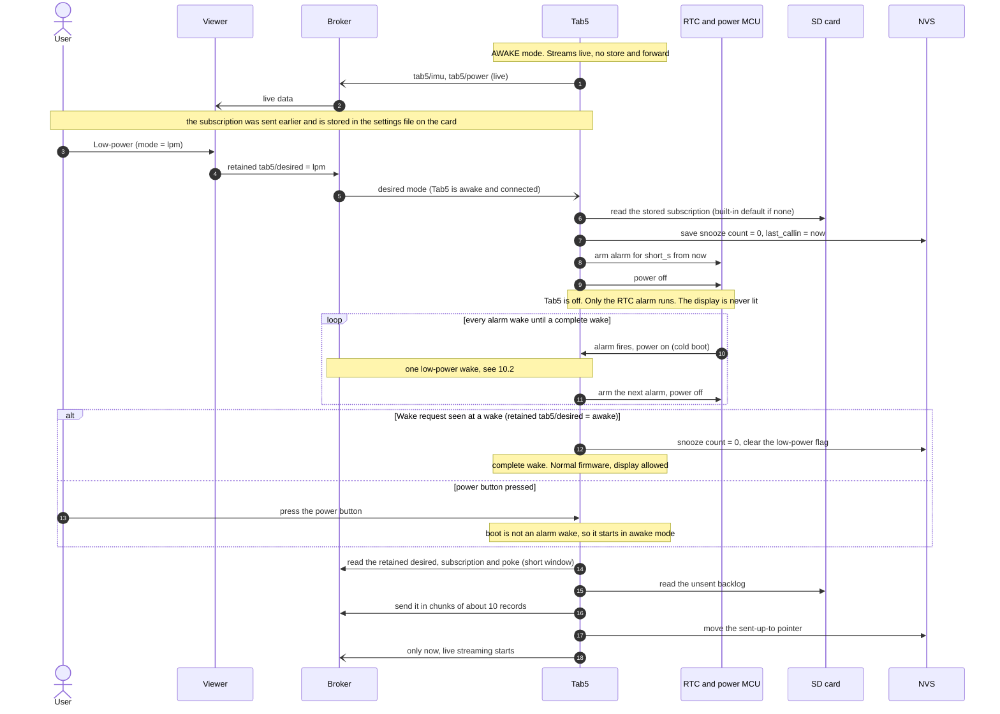
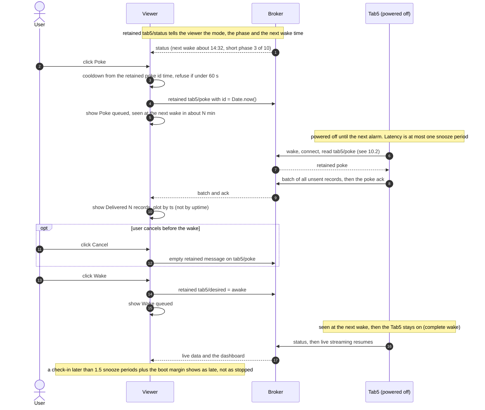

# Low-power mode and subscriptions: design and research

Status: **design only. Nothing in this document is built yet.** It records what was researched, what was tested on the
device, and what was decided, so the work can start from here. Items marked *proposed* were suggested and not objected to but
never explicitly confirmed. Numbers marked *estimate* are not measurements.

## 1. What this is

A low-power mode (LPM) in which the Tab5 spends almost all of its time powered off, wakes on an RTC alarm, records a sample,
checks in with the broker, uploads its recorded data only when the subscription says so (or when the user pokes it), and goes
back to being powered off. How often it wakes and how often it uploads are set by a **subscription**.

Terms used below:

| Term | Meaning |
|---|---|
| Wake | One power-up caused by the RTC alarm. Every wake is a cold boot |
| Snooze | The time between two wakes. Whole minutes, set by the subscription |
| Call-in | An upload of the recorded data to the broker |
| Poke | A user request, from the viewer, that the next wake upload everything |
| Complete wake | Leaving LPM entirely and returning to the normal awake firmware |
| Awake mode | The normal firmware: it streams live and does not store and forward |
| Standby | The existing stay-on reduced mode (screen off, 40 MHz, slow rates). Powered and connected. **Renamed from "sleep mode"** |
| LPM | Low-power mode, the new mode: powered off between alarm wakes. The word "sleep" is retired; nothing is called sleep any more |

### Names and commands

Three states, and each has one name and one way in and out. The old `sleep` and `wake` commands are **removed**, not aliased:
`wake` would mean two different things (leave standby at once, or leave LPM at the next wake).

| State | What it is | Enter | Leave |
|---|---|---|---|
| Awake | Normal firmware, full streaming | the default | |
| Standby | Powered and connected, screen off, 40 MHz, 10 Hz IMU, 2 and 1 readings a second. Instant | `standby` (also `standby on`), the moon tile, the viewer's Standby button | `resume` (also `standby off`), a touch, `screen on` |
| LPM | Powered off between alarm wakes. Not instant: the device only listens at a wake | `lpm` on `tab5/cmd` (device is awake), the Low-power tile, or the viewer writing `tab5/desired` mode `lpm` | `tab5/desired` mode `awake`, seen at the next wake (the viewer's Wake button queues it), or the power button at once |

- `lpm` uses the stored subscription (section 3). It is ignored when already in LPM. From standby it works too.
- No text command ends LPM, because the device is off and cannot hear one. The retained `tab5/desired` is the only remote way.
- The viewer always uses `tab5/desired` for LPM (retained, so it waits for the device); `lpm` on `tab5/cmd` is the same thing for a connected
  device (a tile, or `mosquitto_pub`) and does not touch the retained message.
- `rates slow` / `rates normal`, `ps on` / `ps off`, `panel on` / `panel off` and `cpu <MHz>` keep their names. They are the parts
  of standby, for measuring.

Renames that go with this (to do when it is built, all together so the viewer and firmware agree): the caps token `sleep` becomes
`standby`; the `slp` field in `tab5/power` becomes `stb`; the README "Sleep mode" section becomes "Standby mode"; the viewer's
Sleep button becomes Standby; the moon tile label changes to match. *Proposed.*

## 2. Decisions so far

**Wording:** "USB" in this document means the **USB-C port the pack charges through**. The USB-A port is always called USB-A
(a host output).

**"External power" means every source other than the battery, not only USB-C** (*decided*): USB-C, a supply on the M5-Bus `HVIN`
pins, and any other input the board has, **except the RS485 supply, which is ignored for now** (*decided*). Both rules that depend on it, the low-battery rule (skipped on external power) and decision
17 (a plugged-in device leaves LPM), apply to all of them. Where the text says "USB-C" on its own it means that port only.

1. A subscription is a rule with an `id`, a `name`, a call-in interval `callin_s` (seconds) and a `power` sub-rule that has
   `short_n`, `short_s` and `long_s`.
2. **The subscription is separate from the mode.** The mode (awake or LPM) is set on its own and carries no subscription. After
   that the user only switches the mode.
3. **Both sides hold the full set of rules (the catalog).** The viewer and the Tab5 both know every subscription. The viewer sends
   **only the id** of the active one, and **only when the user commands it**. The Tab5 looks it up in `subscription.json` on the
   SD card, validates it, **saves it among its settings and deploys it** at once. The viewer is the master of the catalog: it
   publishes the **SHA of its catalog**, the Tab5 compares that SHA with its own and **pulls the catalog from the broker only when
   they differ**; the viewer pushes the catalog only when the Tab5 reports a different SHA, or `0` on a first boot (section 3). Until an id has been sent, the built-in default (section 3) is used.
4. The subscription's call-in and power rules are used in **LPM only**; awake mode streams continuously and ignores them. The
   one exception is `poke_enabled`, which is part of the subscription and applies in every mode.
5. The general settings file (on the SD card) holds NTP, broker host, port, sign-in mode, the joystick flips and the
   subscription (which carries `poke_enabled`). **The card is the source of truth and is always synced to NVS** (section 3,
   "Delivery and loading"). **Provisioning saves the same parameters to the card as well as to NVS.** Credentials, certificates
   and the PIN stay in NVS only (*assumed, see the open items*).
6. In LPM everything is off except the wake mechanism (the RTC alarm). **The display is never turned on in LPM.** Only a
   complete wake, or the power button, lights it. Display on/off is a separate, unchanged feature.
7. The snooze counter resets to 0 on entering LPM and on a complete wake, and **when a new subscription is
   applied** (*decided*). A successful call-in does **not** reset it.
8. The radio is turned on at **every** wake, to look for a poke, a mode change and a new subscription.
9. Data is uploaded only at a call-in, or when poked. A poke sends the whole unsent backlog plus a fresh record and also
   updates `last_callin`.
10. The due test is `last_callin + callin_s <= now`, with `last_callin` set to the wake start time (the RTC reading at boot),
    not to the time the upload finished.
11. A poke is always user-initiated (a viewer button). It is never automatic and never made by broker-side logic.
    Poke rate limit: 1 per minute, enforced in the viewer and on the device.
    `poke_enabled` (boolean, **part of the subscription**, default true): when true a poke is accepted; when false the Tab5 does not
    check for pokes at all (see section 5).
12. At every wake the Tab5 also publishes a small retained status, even when it is not uploading.
13. A failed radio attempt is capped at 20 s. Then the Tab5 saves its data and powers off until the next wake.
14. Awake mode streams directly and does not store and forward. **On every awake start** (power button, Wake request, plain
    power-up) the Tab5 first looks at the retained messages, then **sends the saved data (the unsent backlog on the card), and only
    then starts streaming** (see "Start sequence" in section 4).
15. Wake on motion is **shelved** for now.
16. **Low battery, in every mode (LPM, awake and standby): shut down at 6200 mV.** The rule applies only on battery power; while
    charging, or with any other power source, it is not checked. **At every boot** the Tab5 checks the voltage first and, if it is
    below the minimum, arms the alarm and powers off, doing nothing else. **While running**, if the voltage falls below the
    minimum it shows "Battery very low, Shutting Down" in a modal and **sends all the data**, then powers off. In LPM there is no
    modal (the display is never lit); the Tab5 sends a low-battery message to the broker and powers off. See "Low battery" in section 4.
17. **A device in LPM that is plugged in for charging leaves LPM** (*decided*). At its next alarm wake, if USB-C (the charging port) or any other external
    power is present (not battery alone), the Tab5 does a complete wake: it clears `lpm_active`, resets the snooze count, runs the
    start sequence (retained messages, saved data, then streaming) and **stays on**, charging. The snooze count is reset (*decided*). **Unplugging does not
    put it back into LPM; the user has to command LPM manually** (the viewer's Low-power button, the tile, or `lpm`), *decided*. A power-off board cannot notice a plug, and USB-C does not power it on, so the delay
    is up to one snooze period; the power button is the immediate way. *Not known:* whether the power MCU would wake the board on a
    USB-C plug; M5Stack's page says nothing, so it is assumed not.

## 3. Subscription format

### Built-in default (in the firmware, used until the viewer sends one)

```
id 1, name "Default", callin_s 3600, short_n 10, short_s 1800, long_s 7200, poke_enabled true
```

### A subscription rule

```json
{ "id": 2, "name": "Watch", "callin_s": 300, "poke_enabled": true,
  "power": { "short_n": 60, "short_s": 60, "long_s": 300 } }
```

| Field | Type | Rule | Meaning |
|---|---|---|---|
| `id` | integer | 2 to 65535 (1 is the built-in default) | Identifies this version. A subscription is applied when its id differs from the stored one |
| `name` | string | 1 to 24 printable characters | Display name |
| `callin_s` | integer | 10 to 86400 | Upload policy, in seconds |
| `poke_enabled` | boolean | optional, default true | Whether the Tab5 looks for pokes at all (section 5). Applies in every mode |
| `power.short_n` | integer | 0 to 65535 | How many wakes use the short snooze before the long one. 0 goes straight to long |
| `power.short_s` | integer | multiple of 60, at least 60 | Seconds between wakes in the short phase |
| `power.long_s` | integer | multiple of 60, at least `short_s`, at most the alarm limit below | Seconds between wakes in the long phase |

**The `long_s` limit is set by the RTC alarm, not by the ESP32.** The ESP32's own timers allow far longer sleeps, but in LPM
the board is powered off and the RX8130 alarm is the only thing that turns it on. Two ways to arm it:

- Hours and minutes only (what `M5.Power.timerSleep(rtc_time_t)` does, and what the tests used): at most **23 h 59 min**
  (86340 s). Tested.
- Date and time, through the driver's day-of-month alarm (`setAlarmIRQ(date, time)`): reaches up to about 27 days (2332800 s;
  capped below one month so the day number cannot match an earlier month). Present in the M5Unified source, **not yet tested on
  the hardware**. Until it is, treat 86340 s as the limit.

### The catalog, `subscription.json` (on the card, and in the viewer)

The catalog holds **every subscription rule**, each with all the fields above (`id`, `name`, `callin_s`, `poke_enabled`, and
`power` with `short_n`, `short_s`, `long_s`, plus any later fields). The catalog has no version number of its own; its **SHA** is its version:

```json
{ "subs": [
  { "id": 2, "name": "Watch",   "callin_s": 300,   "poke_enabled": true,
    "power": { "short_n": 60, "short_s": 60,   "long_s": 300 } },
  { "id": 3, "name": "Stowed",  "callin_s": 14400, "poke_enabled": false,
    "power": { "short_n": 4,  "short_s": 3600, "long_s": 21600 } }
] }
```

- **The viewer's copy is the master, and it is a file next to `index.html`** (*decided*). The viewer and the Tab5 both hold the whole catalog. The Tab5 reads its copy for lookup
  and writes it only when it receives a new catalog from the viewer. It is never edited by the Tab5 itself.
- **The viewer's copy** (*proposed details*):
  - **Loading** (*tested, see below*): the viewer opens straight from disk (`file://`), where `fetch()` of a sibling file is blocked
    (confirmed). Instead the user picks `subscription.json` once with the File System Access API; the viewer keeps the file handle in
    IndexedDB and reads and writes through it. No `viewer/subscription.js` script is needed. The card keeps plain
    `subscription.json`. If the viewer is later served over HTTP (the PWA idea), it could fetch the file itself.
  - **The version is the SHA-256 of the compact JSON** (*see "Keeping the Tab5 in sync" below*), computed by the viewer from the
    exact string it publishes, never typed by hand. In Chrome opened from disk `crypto.subtle` is available (*tested*: `file://` is a secure context, and its SHA-256 of
    `{"subs":[]}` was `5789cf9021215d79…`, the same as Python's). A small bundled JavaScript SHA-256 is the fallback for other browsers.
  - **Editing:** the viewer manages the catalog itself (see "Managing subscriptions in the viewer" below). Hand editing the file
    still works, then reload the page.
- Ids are unique, 2 to 65535. A rule with id 1 is ignored with a warning (1 is the built-in default, known to both sides).
- **Up to 20 active rules, 40 in all (deprecated ones included)** (*decided*), sent as one retained message with no chunking, in compact JSON (no pretty-printing).
- **Size budget: 300 bytes per rule** (*decided*, to leave room for the data selection below). A rule today is about 112 bytes
  typically and at most about 141 (longest name, widest numbers). 40 rules at 300 bytes is 12 KB plus about 100 bytes of envelope,
  which does not fit the firmware's current MQTT buffer (`mqtt.setBufferSize(2048)`), so the buffer must be raised to **16384**
  bytes (*decided*), about 4 KB of margin. If a rule outgrows 300 bytes, raise the buffer again or move to one topic per rule.
- **The whole catalog is rejected if any rule is bad** (*decided*), so the two sides never end up with different sets. The reason
  goes in the ack, and the catalog on the card is left as it was. The rejected SHA is remembered and not fetched again.
- **Saving a received catalog** (*decided*): nothing is written to `subscription.json` until everything is validated.
  1. Write the received catalog to a temporary file, `subscription.tmp`.
  2. Validate it: read the temporary file back and check every rule. This also proves the write.
  3. If anything is wrong, delete the temporary file, reject the catalog, keep `subscription.json` untouched.
  4. If it is good, swap it in with a rename. **FatFS cannot rename over an existing file** (it returns "exists"; ESP-IDF's
     `vfs_fat_rename` calls `f_rename` directly and does not remove the target, and I took the "exists" result from FatFS
     itself, not from this source), so the swap is: rename `subscription.json` to `subscription.bak`, rename
     `subscription.tmp` to `subscription.json`, delete `subscription.bak`. FAT has no truly atomic replace; this order
     keeps a good copy at every step.
  5. At every boot and wake, before reading the catalog: if `subscription.json` is missing and `subscription.bak` exists,
     rename the backup back; delete a stray `subscription.tmp`.
  *The same temporary-file, validate, swap sequence applies to the settings file when it is rewritten.*

### Managing subscriptions in the viewer: create, read, update, deprecate

The viewer lets the user **create, read and update** subscriptions and **deprecate** them. **A subscription is never deleted**
(*decided*).

- **Create:** a new rule gets an id that was **never used before**: the highest id in the catalog, deprecated ones included, plus
  one. Ids are never reused, so an old record, status or log that names an id always means the same rule.
- **Read:** the viewer lists every rule, deprecated ones included (greyed, with a filter).
- **Update:** a rule is edited in place, keeping its id. A Tab5 that has that rule active redeploys it when the new catalog
  arrives (snooze count reset to 0, as for any change to the active rule).
- **Deprecate:** the rule gets `"deprecated": true` and stays in the catalog. *Decided meaning:*
  - It cannot be **newly selected**: the picker does not offer it, and the Tab5 rejects `{"id": <deprecated id>}` with the reason
    `deprecated`.
  - A Tab5 that **already has it active keeps running it** (it does not fall back to the default), and the status shows
    `sub_deprecated: true` so the viewer can warn "this device is on a deprecated subscription".
  - Un-deprecating (removing the flag) is allowed, because the full rule is kept.
- **The limit** (*decided*): deprecated rules stay in the catalog **with their whole rule** (no stub), so they can be
  un-deprecated. Up to **20 active rules and 40 rules in all**. At 300 bytes a rule that is 12 KB, so **the MQTT buffer is raised
  from 8192 to 16384 bytes** (*decided*; the heap must be checked first, and the JSON parse of a full catalog needs working
  memory on top of the buffer).
- **Saving the changes** (*decided*): the viewer uses the browser's **File System Access API**. The user picks
  `subscription.json` once, and the viewer then writes every change back to that file, so nothing in a deprecated rule is lost.
  It is Chrome (and Edge) only. *Proposed fallback:* where the API is missing or the permission is refused, the viewer offers the
  changed catalog as a **download** to save over the old file.
  **Tested on this machine (Chrome, a page opened from `file://`):** `isSecureContext` is true; `showOpenFilePicker` and
  `showSaveFilePicker` exist; picking a file, overwriting it and reading it back worked (the read-back matched); the file handle
  stored in IndexedDB survived a page reload with the write permission still `granted` and a second write worked without a new
  picker. **Not tested:** a new browser session after Chrome was closed, and other browsers.
- **The catalog loads when the page opens** (*decided*; there is no "Load catalog" button). At page open the viewer reads the
  stored file handle from IndexedDB and, if the permission is still granted (as it was after a reload in the test), reads the
  file silently. The browser rule that cannot be avoided: asking for a permission that has lapsed (after Chrome was restarted) or
  picking the file the very first time **needs a user click**, so the page cannot do it by itself. *Decided:* in that case the
  viewer shows a one-line notice, "catalog not loaded, click to allow", and the click re-grants (or opens the picker the first
  time). It appears only when the permission is not already granted.
- **Until the catalog is loaded the viewer publishes no catalog and no SHA** (*decided*), so that a viewer with no catalog never
  overwrites the retained one, or tells the Tab5 that its catalog is stale.
- After any change the viewer minifies the catalog, computes the new SHA, and the sync described below takes over: the Tab5's
  reported `cat` no longer matches, so the viewer pushes the new catalog (or the user presses Send catalog).

### Keeping the Tab5 in sync with the viewer's catalog

The catalog is large (up to about 6 KB) and **changes rarely, perhaps once in months or years**. So it must not be sent over and
over. Only a small SHA travels regularly; the catalog itself moves only when the two sides disagree (*decided; the topic names and
details are proposed*):

1. **The Tab5 reports its catalog SHA** as `cat` in its retained status. With no `subscription.json` on the card (the first
   boot) it reports **`0`**.
2. **The viewer publishes its own SHA** on `tab5/catalog/sha`, retained, **every 15 minutes** and once when it connects. The SHA
   is the first 16 hex characters of the SHA-256 of the compact JSON, a few dozen bytes.
3. **The viewer sees a mismatch and publishes the catalog.** When the Tab5's reported `cat` differs from the viewer's SHA, the
   viewer publishes the full catalog, retained, on `tab5/catalog`, then its SHA at once. It does this only if the broker's
   retained catalog is not already the right one (the viewer reads the retained `tab5/catalog` when it connects and compares
   its SHA), so a catalog that is already on the broker is not sent again. **It is the viewer that pushes, not Mosquitto**:
   the broker only stores and forwards messages and has no logic of its own. With no viewer open, nothing is pushed, and the
   Tab5 simply keeps what it has (the built-in default on a first boot) until a viewer opens.
   **There is also a manual "Send catalog" button** (*decided*) for when the user wants to push by hand, for example after a
   broker restart wiped the retained messages. It publishes the full catalog, then the SHA, then a **push id** on
   `tab5/catalog/push` (retained, `{"id": <Date.now()>}`, *topic decided*), whatever the SHAs say. **A manual push makes the
   Tab5 download the catalog again even when its SHA already matches** (*decided*): the Tab5 handles a push id that differs
   from the last handled one (kept in NVS), the same pattern as the poke id. The push id is published last, so the catalog is
   on the broker before the Tab5 looks. Because it is a separate retained topic, the periodic SHA message cannot overwrite it
   before a sleeping Tab5 sees it.
4. **At each start or wake** the Tab5 reads only `tab5/catalog/sha` and `tab5/catalog/push` and compares the SHA with the SHA of the `subscription.json` it
   holds (the SHA-256 of the file's bytes: the file is saved exactly as received, so both sides hash the same bytes). A Tab5
   that is **awake and connected** compares every SHA as it arrives, every 15 minutes, without waiting for a wake.
5. **Same SHA and no new push id:** nothing more. The big message is never received.
6. **Different SHA, or a new push id:** the Tab5 asks for the catalog: it subscribes to `tab5/catalog`, receives the retained message, then
   unsubscribes. It checks that the SHA of what it received is the announced one, validates and saves it with the
   temporary-file sequence above, acks it, and re-resolves the active rule. Its status now reports the new `cat`, the SHAs match,
   and the viewer stops publishing.
   **Pull cap and back-off** (*decided*): the Tab5 waits at most **3 s** for the retained catalog in LPM and **7 s** while awake
   (a retained message normally arrives well inside one second, and battery does not matter when awake). If the cap runs out
   (the broker has no catalog, for example the viewer never pushed one, or the volume was wiped), it unsubscribes and **skips catalog pulls for
   the next 3 wakes**, then tries again. A new push id or a different announced SHA ends the back-off at once, and an awake Tab5
   does not back off. This keeps a missing catalog from costing up to 3 s of radio time at every wake. It is deliberately not
   "never retry that SHA": a later push of the same catalog keeps the same SHA, which a never-retry rule would ignore for good.
7. **Rejected catalog:** the Tab5 remembers that SHA in NVS and does not fetch it again until the announced SHA changes or a
   new push id arrives (a manual push is the user asking for a retry). Otherwise every wake would download and reject the same
   bad catalog.
8. **No SHA or no catalog on the broker** (the viewer never pushed one, or the data volume was wiped; a plain broker restart no
   longer loses them, because **persistence is on**, *done 2026-11-15*): nothing to compare or fetch, the Tab5 keeps
   what it has, and the viewer republishes when it next sees a mismatch.
9. **A hand edit of the file on the card** changes its SHA, so the Tab5 reports a different `cat` and the viewer's catalog
   replaces it. The viewer is the master.

A catalog edit on the viewer side means reloading the viewer. It has a new SHA, the Tab5's reported `cat` no longer matches, so
the viewer publishes the new catalog and SHA (or you press Send catalog), and the Tab5 pulls it at its next wake.

The viewer shows "in sync" or "out of sync" from the Tab5's `cat`.

**The SHA, defined exactly** (*decided*), because both sides must get the same value from the same catalog:

- **What is hashed** (*decided*): the SHA-256 of the **minified** catalog, the compact JSON as UTF-8 with no whitespace and no
  trailing newline. The viewer's source file may be pretty-printed; only the minified form is hashed, sent and saved. The
  version is the first **16 lowercase hex characters** (64 bits, enough to tell versions apart; it is change detection, not
  security). Compare case-insensitively.
- **The viewer** canonicalises first (`JSON.parse`, then `JSON.stringify` with no spaces), so extra whitespace in its file
  does not change the SHA, then hashes and publishes those same bytes. Reordering the keys does change it, which only costs one
  harmless resync. Names with non-ASCII characters are encoded as UTF-8 before hashing.
- **The Tab5 saves the received bytes verbatim**: no re-serialising with ArduinoJson, no added newline. Otherwise its SHA would
  never match the viewer's and **every wake would pull the catalog again**. It parses a copy for validation only.
- **The Tab5 hashes the file at every start** (a few KB, well under a millisecond with the hardware SHA), so a hand edit on the
  card shows up as a different `cat`. With no file it reports the string `0`.
- **Payload of `tab5/catalog/sha`:** a JSON object, `{"sha":"<16 hex>"}`, so fields can be added later (for example the rule
  count). The status's `cat` carries the same 16 hex characters.
- **Browser:** `crypto.subtle` is used if available (it should be on `file://` in Chrome, *not verified*), otherwise a small bundled
  SHA-256.
- The SHA says nothing about who sent the catalog: anyone allowed to write `tab5/catalog` can replace it. That is the access list's
  job.

### Reserved for later: what data is published under which subscription

The user wants to control, per subscription, which data is published. Not built, but the format and the size budget leave room
for it now:

- **A `data` field in each rule** (*proposed name and shape*): a list of the data items to include, for example
  `"data": ["bat", "tmp", "imu", "heap"]`, using short keys for the items in the sample record (battery, temperatures, IMU
  summary, joystick, heap, wake source, and so on). A list of names costs about 40 to 80 bytes; a bitmask would be smaller
  but unreadable. A rule without `data` uses the default set, so every rule written today keeps working.
- **Unknown fields are already ignored** (see the checks below), so firmware that does not know `data` yet still loads a
  catalog that has it. Unknown *names inside* `data` are ignored with a warning, for the same reason.
- **Size:** a rule with `data` is about 200 bytes, inside the 300 byte budget above.
- **Open:** the selection could apply when the record is **sampled** (less to store on the card, and the saved record is already
  trimmed) or when it is **sent** (the card keeps everything and the viewer sees only the chosen items). Sampling time is the
  cheaper choice but cannot be undone for records already saved. Each saved record carries its subscription id (section 6), so a
  receiver can tell which set of items to expect. Awake mode ignores the subscription today, so awake streaming is unaffected.

Checks on every rule, when a catalog is received and again when a rule is deployed:

- A snooze period that is not a multiple of 60 is rounded up, with a warning. The RTC alarm only has one-minute resolution.
- `long_s` above the alarm limit is clamped to it, with a warning.
- `callin_s` shorter than the current snooze period means every wake is due, so it behaves as "upload at every wake". This is a
  warning, not an error.
- Unknown fields are ignored so the format can grow.
- An invalid subscription is **rejected**: the stored one stays in use, and the reason is reported in the ack and the status.

### Delivery and loading

- **The viewer sends only the id of the active rule**, on the retained topic `tab5/subscription` (`{"id": 2}`, *decided*), so a
  powered-off Tab5 gets it at its next wake. The Tab5 **looks the id up in `subscription.json`, validates the rule, saves it to
  the SD card among its settings, and deploys it immediately**, and acks it. An id that is not in the catalog, or a rule that
  fails validation, is rejected and the stored subscription stays in use. It is applied when the id differs from the active
  one. A retained message with a different id overwrites a hand edit of the file, and that is accepted (*decided*).
- **Catalog sync** (*decided*): see "Keeping the Tab5 in sync with the viewer's catalog" above. After a new catalog is saved, the
  Tab5 looks the active id up again: if that rule changed, it is redeployed (snooze count reset to 0); if the id is gone, the
  built-in default is used and the status says so (*decided*).
- **It takes effect at once, in the same wake**: the snooze periods (`short_n`, `short_s`, `long_s`) and `callin_s`
  are reloaded, the snooze count is reset to 0, and the due test and the next alarm in this wake already use the new values.
  `last_callin` is not changed. *Decided; the `last_callin` part is my reading of "reloaded".*
- **On the next start** (boot or wake) the Tab5 reads the subscription from the SD card, **validates it again, then deploys
  it**: it loads the values into NVS, as before, and keeps the active subscription in a small struct of about 40 bytes (id, name,
  callin_s, short_n, short_s, long_s, poke_enabled) for use. The cost that matters at a wake is the SD mount and file open.
- **The card is the source of truth; NVS holds a copy that is always synced from the card** (*decided*):
  - At every boot and wake the Tab5 reads the settings file. A valid subscription in it is used, and if it differs from the NVS
    copy, NVS is overwritten. So at a start a hand edit of the file wins over NVS, and so does a card moved from another device
    (the device id check in the open items still applies). A later retained message with a different id replaces both.
  - If the card is missing, or the file is missing or invalid, the **NVS copy is used** and the status says so. If there is no NVS
    copy either, the built-in default is used.
  - A new subscription from the viewer is written to the file first, then to NVS. *Proposed:* if the card is missing (so the file
    cannot be written), it is rejected with the reason "no card", because otherwise the old file would silently overwrite it at
    the next boot.
- The viewer shows what the device holds from the retained status: `sub: {id, name}` for the active rule and `cat` for the catalog
  SHA. A `cat` that differs from the viewer's SHA shows as "out of sync" until the Tab5 next wakes and pulls the catalog. The Send catalog button is always available.
- In awake mode the stored subscription is not used.

### What the default does

Short phase: 10 wakes 30 minutes apart (the first 5 hours). With `callin_s 3600` that is an upload at every second wake, two
records per batch. Long phase: a wake every 2 hours. `callin_s` (3600) is shorter than that, so every wake uploads, one record each.
A poke or a Wake request waits up to 30 minutes in the short phase and up to 2 hours in the long phase.

## 4. The wake flow

```
AWAKE (normal streaming)
  -- enter LPM (mode change from the viewer or a tile), using the stored subscription -->
       snooze count = 0, last_callin = now, save state, arm the alarm, power off

LPM, at every alarm wake:
  1. read the RTC; record the wake start time
  1b. if the device is on USB-C power or any other external power (not on battery alone): leave LPM: a COMPLETE WAKE (below)
  2. sample one compact record (see 6), append it to the card         (display never lit)
     the boot check (on battery and below 6200 mV: arm the alarm, power off) came first; a fall below it later sends the alert and all
     the data, then powers off (see "Low battery" below)
  3. radio up (20 s cap): Wi-Fi, TLS, MQTT
  4. read the retained catalog SHA (pull the catalog only if it differs), then the retained subscription (apply it first: it
     carries poke_enabled), the retained desired mode and, if
     poke_enabled, the retained poke
  5. publish the retained status; apply a new subscription (save to the settings file)
  6. if poked, or last_callin + callin_s <= now:
         upload the unsent backlog (chunks of about 10 records, with a time cap),
         set last_callin = the wake start time, resync NTP and write the result back to the RTC
  7. apply a mode change if there is one (complete wake)
  8. count the snooze; sync the sequence number to the card; arm the next alarm (short_s until short_n wakes have passed,
     then long_s); power off

COMPLETE WAKE (from the desired mode at a wake, the power button, or external power seen at a wake)
  -> normal awake firmware, snooze count = 0, clear lpm_active
  -> the start sequence below: retained messages, then the saved data, then live streaming
```

### Start sequence (every awake start)

Applies to a power-button boot, a complete wake from a Wake request, and an ordinary power-up or reflash alike:

1. Wi-Fi and MQTT up (as today).
2. **Look for the retained messages first**, in a fixed **5 s** window after subscribing (*decided*):
   - `tab5/desired`: the id is stored as applied and it is **not acted on** at an awake start (see the `desired` rules in section 5);
   - `tab5/catalog/sha` and `tab5/catalog/push` first: if the SHA differs from the Tab5's catalog SHA, or the push id is new, pull `tab5/catalog` (own time cap, **3 s in LPM and 7 s while awake**, *decided*, then
     unsubscribe). Then `tab5/subscription` (if its id is new);
   - `tab5/poke`: handled if `poke_enabled` (taken from the subscription, so a new subscription is applied first). The flush in step 3 satisfies it, so it is acked with the records sent, and its id
     is stored as handled (*decided*).
3. **Send the saved data**: the unsent backlog on the card, in chunks of about 10 records, moving the "sent up to" pointer as for a
   call-in. Time cap before streaming starts: **30 s** (*decided*), after which streaming starts and the rest continues in the
   background.
4. **Then start live streaming.** Awake mode itself does not store and forward.

The retained read in step 2 is also what settles the seeding window for `desired`: it is exactly the messages received in that
step, so there is no need to tell a retained copy from a live one.

Notes:

- Sample and save **before** bringing up the radio. This protects the data if the radio fails or the battery dies, and keeps
  radio current out of the battery reading. If the radio fails, give up after 20 s, keep the data and power off.
- If an upload fails, `last_callin` is unchanged. The records stay on the card and the next wake retries.
- Entering LPM from the broker is instant because the Tab5 is awake and connected. A Wake request or a poke is seen at the next
  wake, so the latency is the current snooze period.
- Every awake start **flushes the saved data before streaming** (start sequence below), so the viewer gets the history as soon as the user is at the device.
  This is not a poke: `poke_enabled`, the 1 per minute limit and the poke ack do not apply, and `last_callin` is not used (it is set
  again when LPM is entered). The "sent up to" pointer moves as for a call-in, so a flush that is cut short resumes at the next
  chance. The same flush runs for a **Wake request from the viewer**, whatever
  else is set: `poke_enabled`, the rate limit and the call-in schedule make no difference. The Wake request is only seen at the
  next wake (up to one snooze period later), and then the Tab5 stays on and flushes.
- **A power-button press during an LPM wake counts the same as a power-button boot: a complete wake.** The Tab5 does not power
  off at the end of the wake. It cancels the next alarm, clears `lpm_active`, runs the start sequence (retained messages, saved
  data, then streaming) and stays on. *Decided.* Detecting the press while running is not verified: M5Unified has
  `Power.getKeyState()`, but whether it reports the Tab5's button (which goes through the power MCU) has to be tested.
- The power button is the immediate way out of LPM. How a boot is classified as an alarm wake or an awake start is defined in
  "Telling an alarm wake from any other boot" below.
- Records are appended with a checksum each, and the file is closed before power off, so a torn last record is skipped.
- If the card disappears during LPM, degrade to uploading at every wake and say so in the status.

### Peripherals in LPM (*proposed; the "off" column is by design, not measured*)

**Requirement (user): the display is never turned on in LPM, not even a flash at power-on.** The backlight must stay off for
the whole wake.

| Peripheral | While powered off (between wakes) | During the wake window (about 10 s) |
|---|---|---|
| RTC (RX8130) and power MCU | **On.** They keep the time and fire the alarm. Everything else is cut | On |
| Display panel and backlight | Off | **Backlight stays off.** `M5.begin()` initialises the panel (no config switch skips it; `clear_display` only decides whether it is cleared), so the first thing after it is brightness 0, and the question of skipping the init is open (section 8) |
| IMU (BMI270) | Off | On, for the sample burst only (needs `internal_imu`) |
| Battery monitor (INA226) | Off | On, to read the voltage and percent |
| SD card | Off | On, to save the record and read the settings and catalog |
| Wi-Fi and the C6 | Off | On only once the radio is brought up (20 s cap), off again before power-off |
| Microphone and speaker codec | Off | **Not started**: `internal_mic` and `internal_spk` set to false in the wake path |
| External Port A 5 V (joystick unit) | Expected off (the power MCU cuts the supply; **not verified**), and switched off explicitly before power-off | **Off.** The wake path boots with `cfg.output_power = false` (the default is true, which is why the joystick works when awake), so the joystick is not read in LPM |

**Port A and the other outputs (*decided*):**
1. **At an LPM wake the board boots with `cfg.output_power = false`**, so the Port A 5 V is never switched on. The sample record carries
   no joystick data in LPM.
2. **Before every power-off, the Tab5 calls `setExtOutput(false)` and switches the USB-A host output off**, so nothing depends on how
   the power MCU treats those rails.
3. **Battery charging is left alone**, so the pack keeps charging when USB-C is connected.
Whether the Port A 5 V really is 0 V while the board is off is a test (section 8).

How much current the board really draws while "off", and which rails the power MCU actually cuts, **has not been measured**. It
needs the external meter (section 8). The table is what the design assumes.

### The Tab5's power inputs and outputs (from M5Stack's documentation, 2026-11-15)

| Item | What the documentation says | Notes |
|---|---|---|
| USB-C | Charges the pack; **"can only be charged after the device is powered on and initialized"** | No voltage or PD figure is given. **No charging while the board is powered off**, so in LPM the pack would charge only during the short wake windows. **A device in LPM that is plugged in leaves LPM at its next wake** (decision 17) and then charges while it stays on |
| Battery connector | NP-F550, 7.4 V nominal, 2000 mAh, 14.8 Wh (Tab5 Kit only; the bare C145 has none) | Charger IC IP2326, controlled through IO expander 0x44 (`CHG_EN`, `nCHG_QC_EN`, `CHG_STAT_LED`). Protection below 6 V (see Low battery) |
| M5-Bus `HVIN` (pins 25, 27, 29) | Labelled `HVIN` | **No voltage range is given.** An external supply can come in here |
| M5-Bus `BAT` (pin 30) | Labelled `BAT` | Battery connection on the bus |
| RS485 port | "Power supply range 6 to 24 V" | Unclear whether this is an input to the board or only the transceiver's supply range. **Ignored for now** (*decided*): it is not treated as an external power source |
| Outputs | M5-Bus 5V (pin 28), 3V3 (pin 12), `EXT_5V_BUS` (M5-Bus, the 2.54-10P side port, Port A 5 V; switched by `EXT5V_EN`), USB-A host 5 V (`USB5V_EN`), C6 supply (`WLAN_PWR_EN`) | `EXT5V_EN` and `USB5V_EN` are the rails `setExtOutput` switches. `WLAN_PWR_EN` shows the C6 supply **is** switchable by a pin on an IO expander |
| Monitor | INA226 at I2C 0x41 on the battery path | Measures bus voltage and current. It reports the battery path, not where the power comes from |
| RTC backup | A 70000 uF / 3.3 V supercapacitor | Keeps the time for a while with the battery out |

- **The page gives no pin or signal that says "external power is present".** `M5.Power.isCharging()` exists in M5Unified, but the
  rule "only on battery power" (see Low battery) still needs a way to recognise USB-C or an `HVIN` supply. Candidates, none verified: the
  charger status through the IO expander, the sign and size of the battery current, or the bus voltage. With a deeply discharged
  pack on USB-C the current should be clearly positive, but a pack in protection mode may take no current while the board runs from
  USB-C, which would make the rule shut the device down while it is powered. **This needs a test with a pack that is not deep.**
- The documentation also warns: after power is cut directly, wait 5 s before powering on, or the IMU may fail to initialise.

### Telling an alarm wake from any other boot (*decided*)

Two NVS keys (names within the 15-character limit):

| Key | Type | Meaning | Written | Cleared |
|---|---|---|---|---|
| `lpm_active` | bool | The device is in LPM (powered off between wakes) | Entering LPM, before the alarm is armed | At every awake start |
| `armed_alarm` | Unix seconds | The time the RTC alarm was armed for (a whole minute) | Each time the alarm is armed, after the last RTC change of the wake | Overwritten each time the alarm is armed |

Classification at every boot, once the RTC can be read:

1. `lpm_active` is false: a normal boot (power-up, reflash, button): **awake start**.
2. `lpm_active` is true and the RTC time is **not valid**: an alarm cannot have fired, so the user pressed the button: **awake
   start**.
3. `lpm_active` is true and `armed_alarm - 2 s <= now <= armed_alarm + 90 s`: an **alarm wake**. (The tests booted at
   alarm + 4 s every time; 90 s is a generous bound, 2 s allows for the RTC's 1 s resolution.)
4. Anything else: **awake start**. This covers a button press at any time before the alarm, a dead battery that was recharged
   hours later, and a reflash while the device is flagged as in LPM. **That is the reflash escape**: no special step, any boot
   outside the window is awake. The reset reason (7 on alarm wakes, 11 after a flash) is logged but not relied on, because the
   reason for a button boot has not been measured.

Rules that keep it safe:

- **Write the NVS keys first, then arm, then power off.** If arming the alarm fails, the Tab5 **does not power off**: it stays
  awake and reports the error. It must never end up off with no alarm armed (a low-battery shutdown arms one too, so there is no
  exception).
- `armed_alarm` is computed **after** the NTP resync and the RTC write-back of the same wake, so a clock step cannot make the
  stored time wrong.
- The same value feeds `next_wake` in the status.
- **Open:** the classification needs the RTC, which `M5.begin()` makes available, and `M5.begin()` also initialises the panel.
  So the display-dark question (section 8) decides whether the panel can be skipped.

### Low battery (all modes)

- **Threshold 6200 mV** (3.1 V per cell) for the 2S NP-F550 pack, a firmware constant (*decided by the user*, replacing the first
  choice of 6000 mV). M5Stack's own documentation (2026-11-15, **not measured here**) says the pack **enters protection mode below
  6 V**, with recovery by removing the battery, resetting, reinstalling it and charging over USB-C, and quotes the runtime as
  discharging "from 8.23 V to the 6.0 V shutdown threshold". So 6200 mV acts **200 mV before the hardware's own cut-off**. (This
  corrects my earlier statement that cell protection cuts in near 5.0 to 5.8 V, which was an assumption.)
  Remaining risks, on record (*unmeasured*):
  - The Tab5 keeps drawing a small current while "off" (the RTC and the power MCU). A pack parked just above the limit can drift
    down into protection over days; 200 mV may not be enough margin for a long wait. It depends on the off-state draw, which needs
    the external meter.
  - Bringing the radio up for the alert adds 100 mA or more in bursts, and the pack sags; the board may still brown out before the
    alert is published, so **the alert may not always get out**.
  The value is a constant, so it is easy to raise once the off-state draw and the sag during the alert are measured.
- **How it is measured:** the average of about 8 readings over about 1 s, not one reading, so a noisy sample does not shut the
  device down. At boot the display is dark and the radio is off, so the load is only about 90 mA and the sag is small.
- **When the rule applies** (*decided*): **only on battery power.** While charging, **on USB-C power**, or whenever there is a power source other than
  the battery (an external supply), the rule is not checked at all. *To check:* how the firmware recognises "another power
  source". Today it reports charging, idle or discharging from the current, and an idle state on USB-C looks like a small discharge,
  so the USB-C input voltage (or the charger status) may be needed as well.
- **At every boot** (*decided*): the Tab5 reads the voltage first, before anything else, for every kind of boot (alarm wake, power
  button, power-up, reflash). If it is on battery and below 6200 mV, it **arms the alarm and powers off, and does nothing
  else**: no display, no radio, no sample, no upload. So a dead battery cannot be used until it is charged or USB-C is connected,
  and a device that is plugged in comes out of LPM at its next alarm wake (decision 17). *Decided details:* the alarm uses the current phase's period, the snooze
  count and `lpm_active` are left as they were. The earlier idea of a hysteresis is dropped, because the boot check replaces
  it.
- **While running** (*decided*): awake, standby, or an LPM wake that passed the boot check, and the voltage falls below 6200 mV:
  - **Awake and standby:**
    1. **Show a modal on the Tab5, "Battery very low, Shutting Down"**, before shutting down. *Decided:* in standby the modal
       turns the screen on for the message.
    2. **Send all the data first** (*decided*): publish the retained status with `alert: "low_battery"` (voltage and percent),
       and upload the whole unsent backlog. **No time cap** (*decided*): the Tab5 shuts down when the upload is finished, or when the
       connection is lost (it gives up on an error, it does not wait for ever). *Risk, on record:* at this voltage a long upload can
       brown the board out before it ends. The "sent up to" pointer moves only after a batch went out, so the data is not lost; what
       was not sent stays on the card and goes out later.
    3. **Power off**, arming the alarm too (*decided*), so a device that was charged comes back through the boot check; the
       period is the current phase's.
  - **LPM wake** (*decided*): **no modal**, because the display is never lit in LPM (decision 6). The Tab5 brings the radio up (20 s
    cap), **sends a low-battery message to the broker** (the retained status with `alert: "low_battery"`, voltage and percent),
    and that is all: it arms the alarm and powers off. *My reading:* it does not upload the backlog here. The data stays on the
    card and goes out at the next awake start (the start sequence), so nothing is lost, and a long radio session at 6.0 V is avoided.
- **The limit applies in every mode** (*decided*).

The same flow as sequence diagrams is in section 10.

## 5. Messages (proposed)

Control uses **retained** topics so a message waits for a powered-off device. *Decided: the broker holds the message until the
Tab5 next connects.* A single retained topic keeps only the latest
message, so a poke could overwrite a pending wake. Hence separate topics for poke, mode and subscription.

| Topic | Direction | Content |
|---|---|---|
| `tab5/poke` | viewer to Tab5, retained | `{"id": <unique, e.g. Date.now()>}`. Handled when the id differs from the last handled one (kept in NVS). Robust to viewer clock skew and to several viewers |
| `tab5/desired` | viewer to Tab5, retained | The mode only: `{"id": <unique>, "mode":"awake"}` or `{"id": <unique>, "mode":"lpm"}`. Applied when the id differs from the last applied one (kept in NVS). **Decided.** Without the id a stale retained `lpm` would send the device back into LPM after a power-button wake |
| `tab5/subscription` | viewer to Tab5, retained | `{"id": <rule id>}`, the active subscription. Applied when the id differs from the active one. Acked (same ack channel as the poke ack, topic not yet chosen) as `{id, status:"applied"}` or `{id, status:"rejected", reason}` |
| `tab5/catalog/sha` | viewer to Tab5, retained | The SHA of the viewer's catalog (first 16 hex characters of the SHA-256 of the compact JSON). Read at every start and wake. Published at viewer connect and every 15 minutes, and straight after a catalog push *(topic name decided)*. A connected Tab5 compares each one as it arrives |
| `tab5/catalog/push` | viewer to Tab5, retained | `{"id": <Date.now()>}`, published last by the manual Send catalog. A new id (different from the last handled one, in NVS) makes the Tab5 download the catalog again even if the SHA matches *(name decided)* |
| `tab5/catalog` | viewer to Tab5, retained | The whole catalog (section 3), up to about 6 KB. Published by the viewer when the Tab5's reported `cat` differs (or is `0`), or when the user presses **Send catalog**. **Read by the Tab5 only when the SHA differs**, then unsubscribed. Acked as `{sha, status:"applied"}` or `{sha, status:"rejected", reason}` *(decided)* |
| `tab5/status` | Tab5 to broker, retained | Battery percent, mode, snooze phase and count, the next wake time, the stored subscription `{id, name}`, `poke`, `clock`, and `desired` (the applied `tab5/desired` id, **decided**: the viewer shows a request as queued until the status shows its id applied). Published at every wake, so the viewer can tell powered off from dead |
| poke ack | Tab5 to broker | `{id, ts, records_sent}` or `{id, status:"rate_limited"}` |
| Data batch | Tab5 to broker | Records with their own Unix `ts` (see 6) |

Poke rate limit, 1 per minute:

- **Viewer:** the button disables itself with a countdown. The cooldown comes from the timestamp in the retained poke's id, so
  it survives a reload and is shared between viewers. A cancel (an empty retained message) does not reset it. A second poke while
  one is pending replaces it.
- **Tab5:** ignore a poke less than 60 s after the last handled one (RTC time, last handled time in NVS) and ack it as
  `rate_limited`.

`poke_enabled`:

- **true:** the Tab5 checks the retained `tab5/poke` at each wake and handles it as above.
- **false:** the Tab5 does not check for pokes. It does not read `tab5/poke`, does not act on it and sends no ack. Call-ins
  and desired-state changes work as usual.
- The flag is part of the stored subscription, so it arrives with a subscription (from the viewer, or by editing the file on the
  card) and is synced from the card to NVS like the rest. The broker still lets a viewer write `tab5/poke` (the access list is a
  static file); the Tab5 just never looks at it.
- The status message carries the flag (`poke: true|false`) so the viewer can grey out the Poke button when it is off.
- **Re-enabling handles a stale poke and clears it.** When the value read from the card (or from a new subscription) is true and the NVS copy was false, the Tab5 notes that in NVS. At
  the next wake (or awake start) with the radio up it reads the retained `tab5/poke` and **handles it like any poke**: uploads the
  backlog, sends the ack with the records sent, stores the id as handled. Then it **clears it** (publishes an empty retained
  message). This happens once per re-enable. The usual rules still apply, so a poke less than 60 s after the last handled one is
  acked `rate_limited` (and still cleared). *Decided.*
- The clear needs no access-list change: the device lists (`broker/acl.devices`, `broker/acl.certs`) already allow read and write on
  `tab5/#`.

The `tab5/desired` rules (**decided**):

| When | What the Tab5 does |
|---|---|
| Awake and connected, a `desired` arrives (live, or the retained copy after a reconnect) | If the id differs from the applied one, apply it and store the id. `lpm` enters LPM. `awake` does nothing (already awake) |
| LPM alarm wake, radio up, retained `desired` read | If the id differs, store it. `awake` means a complete wake, then the start sequence (section 4). `lpm` means no change |
| Any awake start (power button, Wake request, plain power-up, reflash) | The retained `desired` read in the start sequence is stored as applied and **not acted on** |
| `lpm` from the tile or `tab5/cmd` | Does not touch the retained message or the applied id |

Ids are compared for difference, not order, so a viewer with a wrong clock does no harm; the last writer wins. A request written
in the second or two of an awake start is swallowed by the seeding (accepted). If power is lost before the id reaches NVS the
same message applies again at the next wake, which is harmless. Bad messages are handled as below (*decided*). Still to specify: the viewer's queued and applied states.

**Bad `tab5/desired` messages** (*decided*). The rule is **fail safe: a bad message never changes the mode and never powers the
device off.** It is ignored, its id is **not** stored as applied (so a corrected message can be applied), and the reason is
logged on the serial port and reported once in the status as `desired_err`.

| Message | What the Tab5 does | `desired_err` |
|---|---|---|
| Empty payload (a cleared retained message) | Ignore. This is how a stale message is removed, not an error | none |
| Not valid JSON, or not an object | Ignore | `bad_json` |
| `id` missing, not a whole number, zero or negative | Ignore (0 is reserved to mean "none applied") | `bad_id` |
| `mode` missing, or not `"awake"` or `"lpm"` (including the retired word `"sleep"`; no aliases) | Ignore | `bad_mode` |
| Extra unknown fields | Ignore the fields, apply the rest if it is otherwise good | none |
| Good message, `id` equal to the applied one | Nothing to do. A hand-published message that reuses an id with a different mode is ignored for the same reason | none |
| Bigger than the MQTT buffer | The client library drops it before our code sees it, so it cannot be reported | none |

- `desired_err` is cleared the next time a good message arrives. A bad retained message stays on the broker, so the Tab5 sees it
  again at every wake; it is parsed again and ignored, which costs almost nothing, and the status keeps showing the error until
  a good message replaces it.
- The viewer builds the message itself, so a bad one only comes from a hand-published `mosquitto_pub`. The viewer shows
  `desired_err` as "the device ignored your request: <reason>" instead of leaving "queued" on screen.
- The ids are 64-bit on the device (`Date.now()` is a 41-bit number today, but the check should not assume 32 bits).

Viewer button states: Poke, Poke queued (with "seen at the next wake in about N min" from the status), Delivered (N records),
Ignored: too soon. The viewer's access list (`broker/acl.viewer`) must be extended so it can write `tab5/poke`, `tab5/desired`,
`tab5/subscription`, `tab5/catalog`, `tab5/catalog/sha` and `tab5/catalog/push` (MQTT access rules match a topic exactly, so each
sub-topic needs its own line). It currently writes only `tab5/cmd`.

The viewer must plot by `ts` (Unix ms), not by the uptime `t`: every wake is a cold boot, so `t` restarts each time, and a batch
arriving late has to land in the right place on the chart.

## 6. The sample record (proposed)

One compact record per wake, with a sequence number and its own `ts`:

- battery voltage, current and percent; chip and IMU temperature
- a short IMU burst summary (mean, min and max over about 1 s); joystick state if present
- free heap, wake source, snooze phase and count, the stored subscription id

Not available in LPM: Wi-Fi signal strength (the radio is off when the sample is taken). The live 100 Hz IMU stream cannot be
captured in a short wake.

Delivery is at least once: each record has a sequence number, and a "sent up to" pointer moves only after the whole batch went
out and the link was still up. PubSubClient publishes at QoS 0 only, so a connection drop mid-batch would otherwise lose data
silently. The receiving side removes duplicates by sequence number. Backlog is capped by size on the card (about 150 B per
record is tiny against 30 GB).

**The sequence number** is kept on the SD card and worked on in NVS. At boot it is read from the card and written to NVS, used
from there during the wake, and written back to the card before the board powers off. Surviving a reflash (which erases NVS)
is the point of the card copy. *Proposed details:*

- If both copies exist and differ, take the larger one. If the log's last record carries a higher number (power lost before the
  write-back), take that.
- If the card is missing, use NVS alone and write back when the card returns.
- A swapped or reformatted card with an erased NVS still restarts the numbering, and the receiver's dedup would then drop the new
  records as duplicates. A boot or session id in each record, deduplicating on `(session, seq)`, would close that. Open.

State kept in NVS (it must not depend on the card mounting at every wake): `last_callin`, snooze count, the working copy of the
sequence number, last handled poke id, last applied desired-mode id, last applied subscription id, last handled catalog push id, the last rejected catalog SHA, the catalog-pull back-off counter, `lpm_active`, `armed_alarm`.

## 7. What was researched and tested

### RTC alarm wake works

- M5Unified 0.3.0 has `M5.Power.timerSleep(rtc_time_t)` (and a date and time overload). It arms the RX8130 alarm and then
  powers the board off; the alarm powers it back on. On the Tab5, power-off pulses an I/O-expander pin ten times and the power
  MCU cuts power.
- **Resolution is one minute** (hours and minutes only; seconds are ignored). `timerSleep(seconds)` is unsupported on the Tab5.
  So snooze periods must be whole minutes.
- The RX8130 driver in M5Unified also has a day-of-month alarm (the WADA bit, `setAlarmIRQ(date, time)`), which would allow a
  snooze of weeks. Read from the source only; not tested on the hardware.
- Every wake is a **cold boot**; nothing in RAM survives.
- The RTC interrupt goes through the PMS150G-U06 power MCU (M5Stack documents the wiring and says the RTC "supports timed
  interrupt wake-up"; it does not say it powers on from off, which the tests confirmed).
- Wake works with USB-C plugged in, and on battery. With USB-C plugged in the board still powers off; the USB port disappears
  while it is off and returns at the wake.

### USB-C test (6 cycles, `spike/alarmtest.cpp`)

Every wake came back at the same second past the minute. The device powered off and on each time.

### Battery test (12 wakes, `spike/alarmlogtest.cpp`, log on the SD card)

| Result | Value |
|---|---|
| Wakes classified as RTC alarm | 12 of 12 |
| Boot logged after the armed minute | 4 s, every time |
| Armed to next boot | 294 s, every time |
| RTC drift against NTP over about an hour | 0 s (1 s resolution) |
| Reset reason on alarm wakes | 7 (after a flash it is 11) |
| Awake draw at boot, radio off, display dark | about 93 mA, roughly 0.77 W |
| Awake draw with screen lit and Wi-Fi (boot 13) | about 172 mA, roughly 1.4 W |
| Awake window per cycle | about 10 s (about 8 J, *estimate*) |
| Battery voltage, boot 2 to boot 12 | 8325 to 8297 mV |

The voltage drift is **not** usable as a power measurement: the pack had just come off the charger, so surface-charge
relaxation swamps the signal.

### The RTC and the system clock (a trap, now confirmed)

- `M5.begin()` calls `M5.Rtc.setSystemTimeFromRtc()`, so `time(nullptr)` looks valid at boot whenever the RTC holds a date after
  2023.
- The main firmware gates NTP on `time(nullptr) < 1700000000`, so with a valid RTC it never asks NTP. After the battery test
  the RTC is correct, but `ts` is about 1.3 s off the computer clock instead of about 0.1 s (the RTC has 1 s resolution), and
  nothing will correct it over time.
- The first test set the RTC from the build time, which is local time, so it stored local time as UTC (it was 6 h and 24 s behind).
- Fix needed before any alarm feature: use a real SNTP sync (clear the system clock, or check the SNTP status) and write the
  result back to the RTC in UTC. The battery test did exactly that at boot 1.
- **Decided:** if NTP is not available, fall back to the RTC as it is. NTP is resynced at **every call-in** and the result is
  written back to the RTC in UTC. The status carries `clock` (`ntp`, `rtc` or `invalid`) so the viewer can tell how far to trust
  `ts`. *(The `clock` field is proposed.)*

### Sleep options that are blocked

- P4 light sleep between wakes needs power management and esp-hosted host power save. Both are **compiled out** of the prebuilt
  Arduino libraries (`CONFIG_PM_ENABLE` is not set; `CONFIG_ESP_HOSTED_HOST_POWER_SAVE_ENABLED` is not set). Using them would
  mean rebuilt libraries and a C6 firmware with host power save, whose presence on the Tab5 is unknown.
- The RTC slow clock source in the build is the internal RC, so a P4 timer wake would be imprecise.
- `deepSleep(micro_seconds)` exists for the P4 but keeps the other rails (C6, display) powered; its power is unmeasured and the
  esp-hosted link must be re-initialised on wake.
- Power measurement: the INA226 only works while the P4 runs and has no accumulator, so **the off-state draw cannot be read
  from the Tab5**. It needs an external logging meter in the battery path (a PPK2 or Otii class device). The user deferred this.

### Energy picture (*estimate*, all unmeasured except the awake figures above)

A sample-only wake costs a boot, a quick read and an SD write, with no radio. A radio wake adds a Wi-Fi join (about 3 to 4 s,
measured on this network), TLS and MQTT (not measured). With the radio up at every wake, the snooze periods are the energy lever
and `callin_s` becomes an upload policy. Illustration only, at 10 J per wake: a 30 minute snooze averages about 5 mW and a 2 hour
snooze about 1.4 mW, which is below what the unmeasured off-state draw is likely to be.

## 8. Open items and things to measure

| Item | Notes |
|---|---|
| Radio-wake cost | A spike that logs each step's time: boot, Wi-Fi up, TLS up, MQTT up, poke read, publish, power off. Try caching the BSSID and channel, and skip the NTP wait (the RTC has the time) |
| Display during LPM | `M5.begin()` initialises the panel by default. Check whether the wake path can skip it, and whether the backlight flickers between power-on and our code. The battery test kept brightness at 0; the user has not confirmed it stayed dark |
| Port A 5 V while off | With no unit plugged in and the device in LPM between wakes, measure the 5 V pin of Port A with a multimeter. 0 V means the rail is off; about 5 V means it stays on and drains the pack |
| External power detection | **Deferred by the user ("later").** How the firmware recognises USB-C or `HVIN` power, which the low-battery rule (skipped on external power) and decision 17 (leave LPM when plugged in) both need. When it is done: log `isCharging()`, the INA226 current and voltage, and the charger status while USB is plugged in at a healthy battery level, then unplugged; and check a pack in protection mode, which may take no charge current while the board runs from USB |
| Margin of the 6200 mV limit | Decided at 6200 mV, 200 mV above M5Stack's 6 V protection. Whether that is enough depends on the off-state draw (external meter) and the sag during the alert |
| Off-state power | Needs the external meter. Deferred by the user |
| NTP and RTC fix | See 7. Needed before building |
| Rename work | Decided (see "Names and commands" in section 1). Not done: firmware, viewer, README and the caps and `slp` fields all change together |
| Date alarm test | Verify the day-of-month alarm on the hardware before allowing `long_s` above 86340 s |
| Uploaded data has no home | A call-in publishes at QoS 0, non-retained. With no subscriber connected at that moment the batch is lost. Needs an always-on collector with a persistent session, or a viewer-side store (the PWA). Decision needed before the LPM build |
| Viewer catalog file details | Decided: the viewer's catalog is a file next to `index.html`, its version is its SHA, the viewer manages it (create, read, update, deprecate, never delete) and saves changes with the File System Access API. Tested: the API works from `file://` in Chrome, and the permission survived a reload. Decided: it loads at page open, with no Load button. Open: whether to keep the download fallback (I recommend dropping it if you only use Chrome), and a test of what happens after Chrome is restarted |
| Deprecation details | Decided: whole rule kept, 20 active and 40 in all, a 16384 byte buffer, and the meaning of deprecated (not newly selectable, a device already on it keeps running it, un-deprecating allowed). To check: the heap for a 16 KB buffer and the JSON parse |
| Per-subscription data selection | Not built. The `data` field, its names, the 300 byte rule budget, and sampling-time versus send-time selection are in section 3 |
| Record contents | Section 6 is a proposal |
| Detecting the power button during an LPM wake | Behaviour decided (complete wake, stay on). To test: does `M5.Power.getKeyState()` see the Tab5's button while running? |
| Sent records on the card | Whether delivered records are deleted, marked, or kept until the card is full (see backlog policy) |
| Poke ack and status fields | Section 5 is a proposal |
| 1 s jitter in the due test | The due test is plain `<=`. A 60 s tolerance was offered as insurance and declined; the alarm test showed a constant 4 s boot offset |
| Wake on motion | Shelved. The BMI270 interrupt appears to share the power MCU wake line with the RTC (from M5Stack's documentation, unverified) |
| Settings file on the SD card | Decided: the card is the source of truth for all settings and is always synced to NVS; provisioning writes the same parameters to the card. Also decided: (1) credentials, certificates and the PIN are **not** written to the card, because it is removable; (2) if the card has no file but NVS has values, write the file from NVS; (3) a runtime change of a setting (for example a joystick flip) writes the card as well, or the next boot would revert it; (4) the file carries a device id (the MAC), and a file for another device is ignored with a warning, because otherwise a card moved between Tab5s would silently change the broker, the NTP server or the sign-in mode |

## 9. Suggested build order

1. Subscription parser and checks (built-in default, one stored subscription in the settings file), the settings file, the
   sequence-number sync, and the NTP and RTC fix. None of it needs new hardware testing.
2. Viewer: the subscription manager (create, read, update, deprecate), the active-rule picker (the viewer sends only the id, and can send the whole catalog), the mode switch, the poke button with its states, the status display, plotting
   by `ts`, and the access list change.
3. The radio-wake spike, then the LPM wake path itself.
4. Power measurement with an external meter.

## 10. Sequence diagrams

The first diagram is the whole life of the device. The second is one low-power wake in detail. The third is what the user does
from the viewer. Participants: the **Tab5** firmware, the **RTC** (the RX8130 alarm and the power MCU that powers the board on
and off), the **SD card**, **NVS**, the **broker** (Mosquitto, which only stores the retained messages) and the **viewer**.

### 10.1 Life of the device: awake, LPM, wakes, complete wake



### 10.2 One low-power wake

```mermaid
sequenceDiagram
    autonumber
    participant R as RTC and power MCU
    participant T as Tab5
    participant N as NVS
    participant S as SD card
    participant B as Broker

    R->>T: alarm fires, board powers on (cold boot)
    T->>R: read RTC, wake start W = now
    T->>S: read the settings file (stored subscription), sequence number
    T->>N: load state (snooze count, last_callin, handled poke id, applied desired id), seq working copy
    T->>S: append one sample record with ts, display stays off
    Note over T: the boot check runs first, before anything else: on battery and below 6200 mV means arm the alarm and power off, nothing else. If the voltage falls below it later in the wake, the Tab5 sends the alert and all the data (awake and standby, no cap) or only the alert (LPM), then powers off; no modal in LPM
    T->>B: Wi-Fi, TLS and MQTT connect (20 s cap)

    alt radio failed within 20 s
        Note over T: keep the data on the card and go straight to counting the snooze
    else radio is up
        B-->>T: retained tab5/desired, tab5/catalog/sha (and tab5/catalog only if the SHA differs) and tab5/subscription
        T->>B: retained tab5/status (battery, mode, phase, count, next wake, poke_enabled)

        opt poke_enabled is true
            B-->>T: retained tab5/poke
        end

        alt poke_enabled and the poke id is new and at least 60 s since the last poke
            T->>S: read the unsent backlog
            T->>B: batch in chunks of about 10 records
            T->>B: poke ack with the id and records sent
            T->>N: last_callin = W, handled poke id = this id
        else poke_enabled and the poke id is new but less than 60 s since the last poke
            T->>B: poke ack = rate_limited
        else last_callin + callin_s <= now
            T->>S: read the unsent backlog
            T->>B: batch in chunks of about 10 records
            T->>N: last_callin = W
        else nothing due
            Note over T: no upload this wake (a poke is never looked at when poke_enabled is false)
        end

        opt subscription id is new
            T->>S: validate, write to the settings file
            T->>B: ack applied or rejected
        end

        opt desired mode is new and is awake
            T->>N: apply it (complete wake)
        end
        T->>B: disconnect
    end

    T->>N: snooze count + 1, save state
    T->>S: write the sequence number back to the card
    Note over T: next period is short_s while count is below short_n, otherwise long_s
    T->>R: arm the next alarm (whole minutes)
    T->>R: power off
```

### 10.3 What the user does from the viewer: poke, status, wake


