# Design mockups

These are the design mockups made before and during the build of first-run setup, rendered one state per picture. They are
**designs, not photos of the device**: they show what was agreed, and where the finished firmware differs the note under the
picture says so. The Wi-Fi name `Ptolemaios` and the other network names are examples.

## On the Tab5 screen

Shown at half size (the screen is 720 x 1280).

<table>
<tr>
<td align="center" valign="top" width="33%">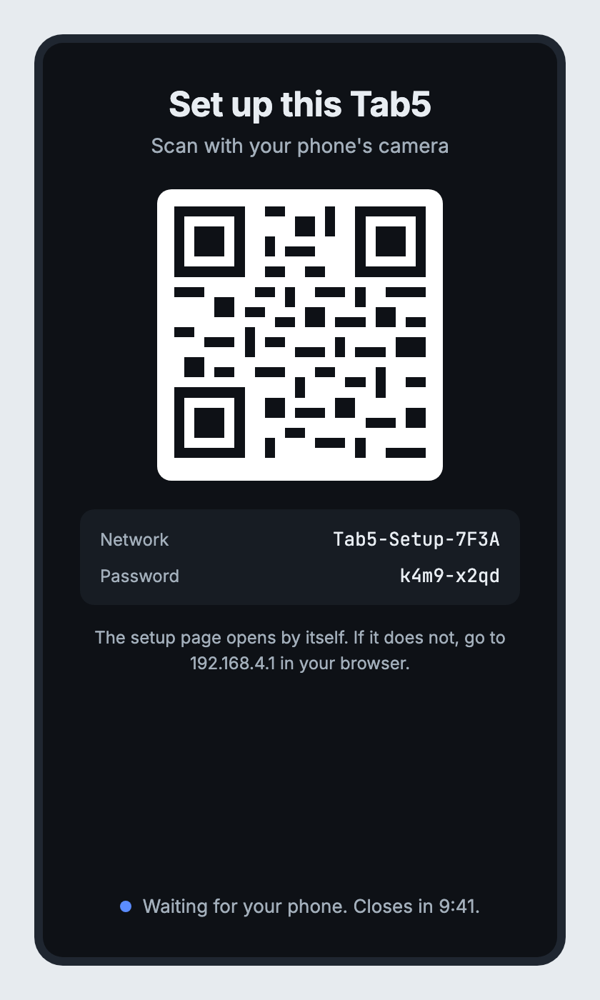 <b>1. Scan</b> Shown on first start and when setting up again. Closes by itself after 10 minutes. The QR code here is a placeholder pattern; the real screen draws a real one.</td>
<td align="center" valign="top" width="33%">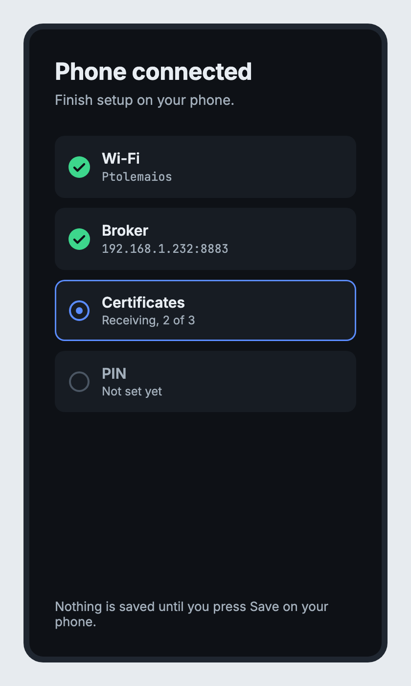 <b>2. Phone connected</b> Shown while the phone fills in the setup page. The finished firmware lists all four items as waiting until Save is pressed, rather than ticking them off live.</td>
<td align="center" valign="top" width="33%">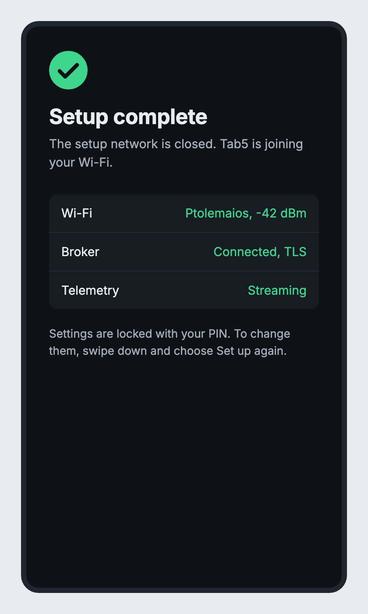 <b>3. Setup complete</b> Shown for a few seconds after saving, then the Tab5 restarts onto the new settings.</td>
</tr>
<tr>
<td align="center" valign="top">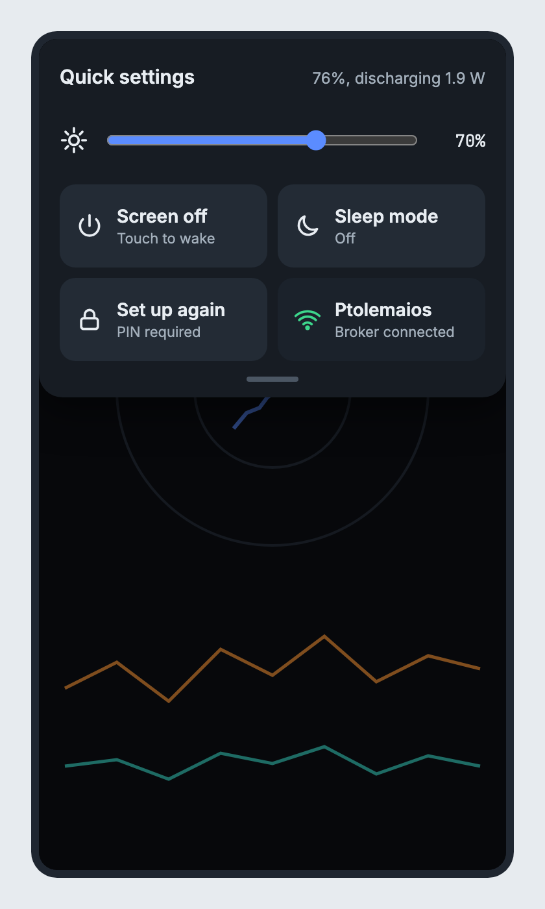 <b>Quick settings</b> Swipe down from the top edge. The finished panel is icon-only: a power symbol (screen off), Wi-Fi and server symbols (link status), a moon (sleep) and, in a second row, a padlock (set up again). The brightness slider and the battery line are as drawn here.</td>
<td align="center" valign="top">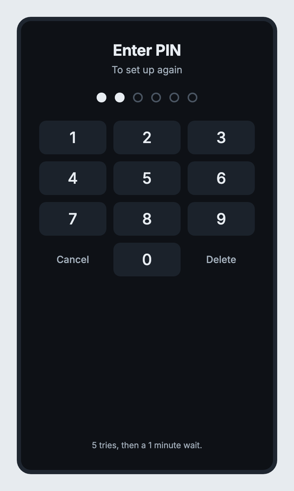 <b>PIN keypad</b> Asked before setting up again. The finished screen has no "5 tries" line; it shows "Wrong PIN." or a lockout countdown instead.</td>
<td></td>
</tr>
</table>

Not shown: the sleeping screen, which is simply black.

## The setup page on the phone

The page that the Tab5 serves from its own Wi-Fi network. Five steps, then a confirmation.

<table>
<tr>
<td align="center" valign="top" width="33%">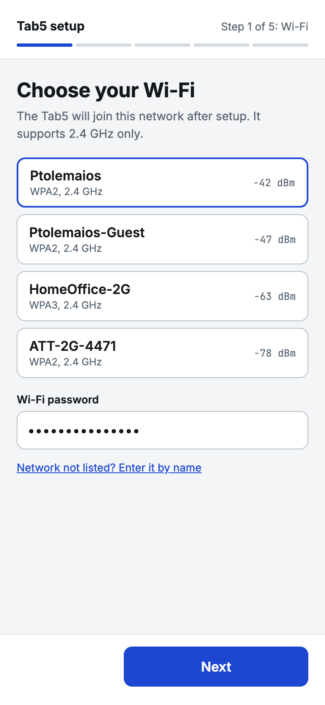 <b>Step 1: Wi-Fi</b> Pick a scanned network or type the name, and enter the password. 2.4 GHz only.</td>
<td align="center" valign="top" width="33%">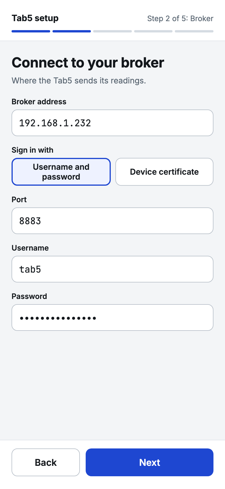 <b>Step 2: broker, username and password</b> Port 8883.</td>
<td align="center" valign="top" width="33%">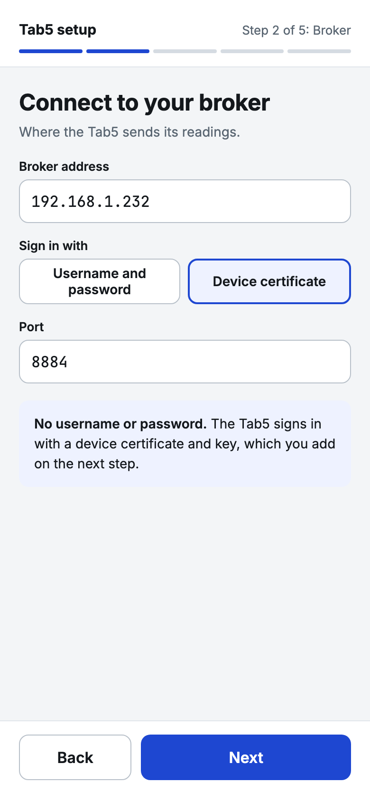 <b>Step 2: broker, device certificate</b> Port 8884. No username or password.</td>
</tr>
<tr>
<td align="center" valign="top">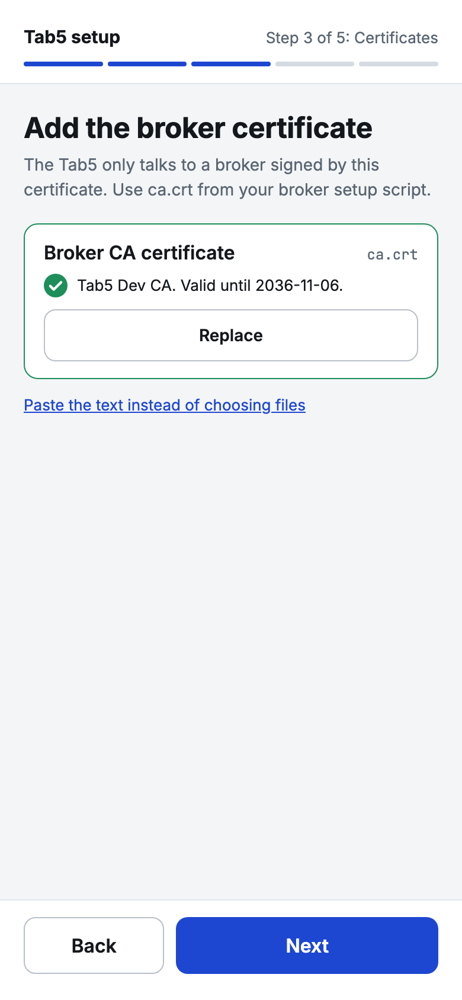 <b>Step 3: certificates, password path</b> Only the broker CA certificate is needed.</td>
<td align="center" valign="top">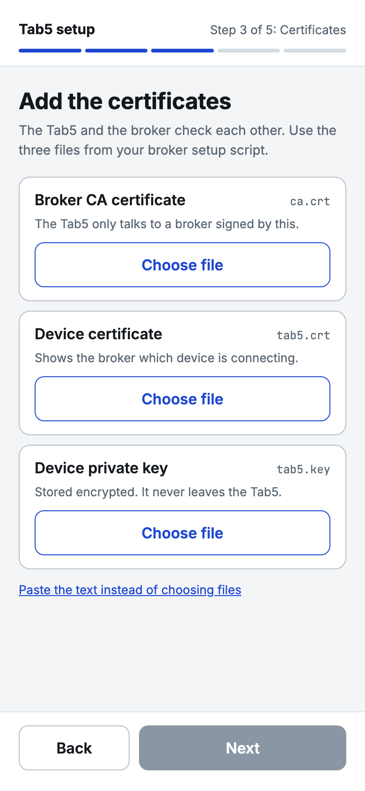 <b>Step 3: certificates, device certificate path</b> CA certificate, device certificate and device key, each chosen as a file or pasted. Next stays grey until all three are in.</td>
<td align="center" valign="top">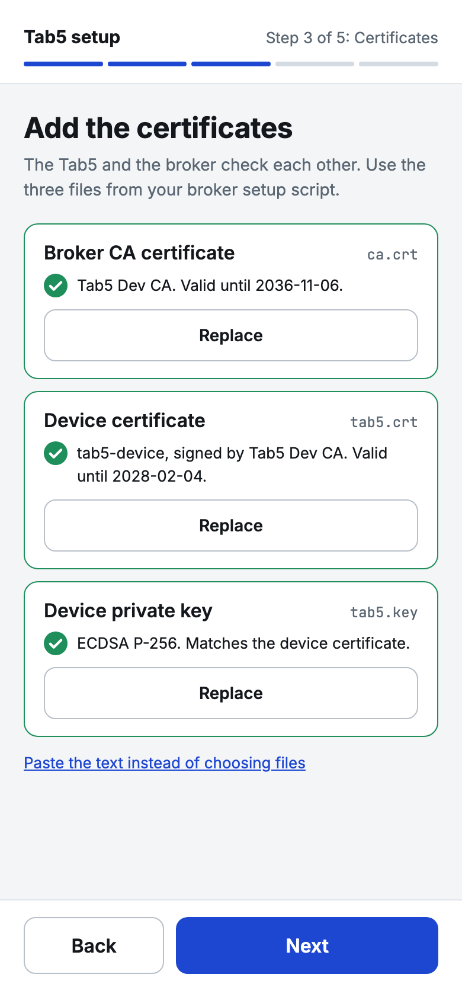 <b>Step 3: all accepted</b> The Tab5 reads each one and reports what it found.</td>
</tr>
<tr>
<td align="center" valign="top">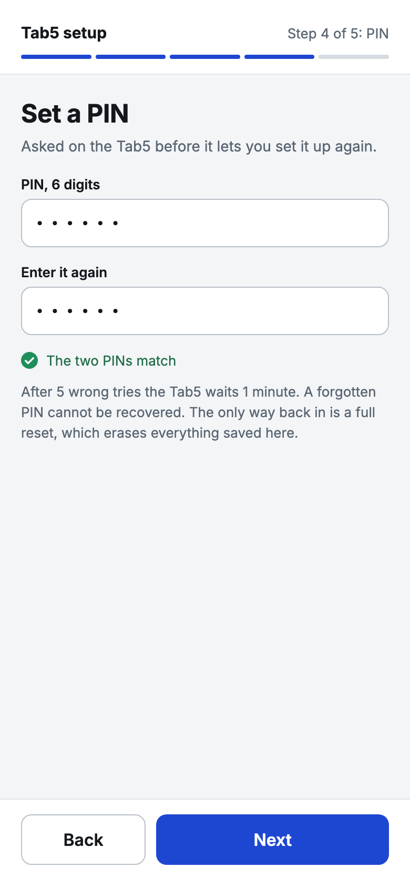 <b>Step 4: PIN</b> Six digits, entered twice. Asked on the Tab5 before it lets you set it up again.</td>
<td align="center" valign="top">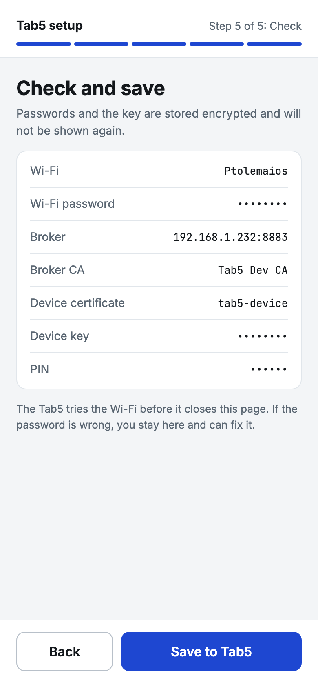 <b>Step 5: check and save</b> Secrets are masked. The finished page says the Tab5 reopens setup if the new settings cannot connect; it does not hold this page open to test them, because the setup network drops when the Tab5 joins your Wi-Fi.</td>
<td align="center" valign="top">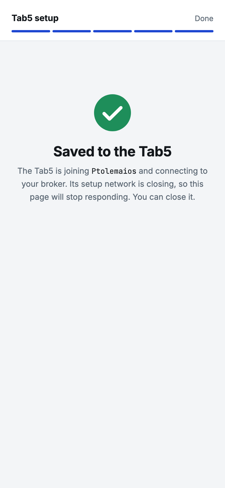 <b>Saved</b> The Tab5 restarts, so this page stops responding and can be closed.</td>
</tr>
</table>

## Sleep mode: the original plan

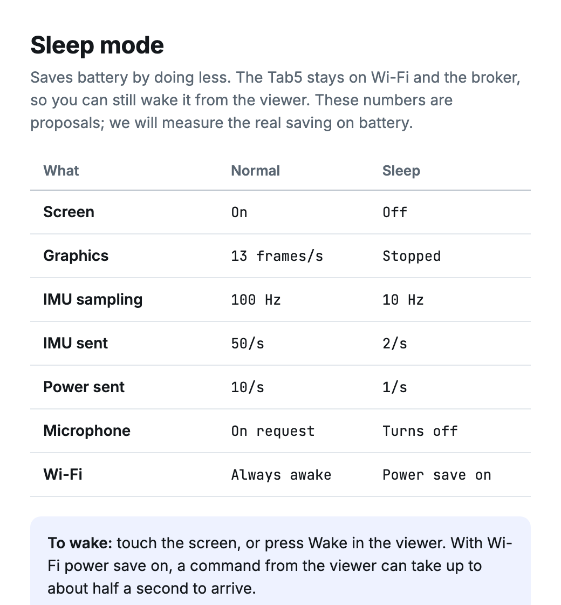

This is the plan from before sleep mode was built, kept for the record. **It is superseded.** The measured results are in the README: Wi-Fi power save saved nothing, the CPU clock drops to 40 MHz, and the display panel stays awake so that touch can wake the screen.
